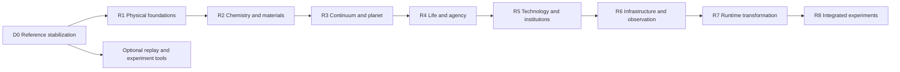
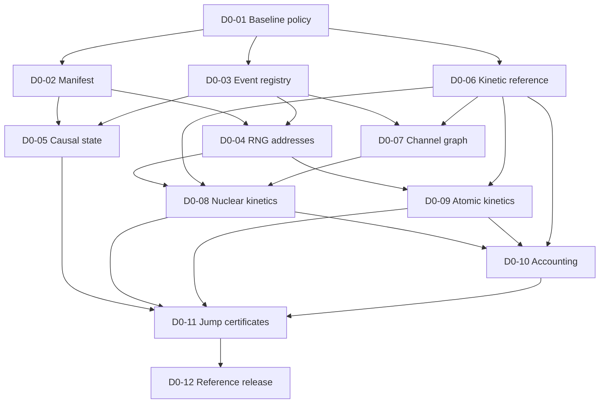

# SimWorld development specification and execution roadmap

**Planning version:** 1.0 · **Date:** 30 October 2026  
**Current executable baseline:** `physics_build 0.1` at commit `2a74160e5934fe76b8e14726d78ba6e2c3c7d40f`  
**First implementation milestone:** D0 — establish a trustworthy reference baseline.  
**Ready to start:** D0-01 — freeze the historical baseline and define change control.

This is the working development plan assembled from [ROADMAP_DIFF.md](ROADMAP_DIFF.md), [ROADMAP.md](ROADMAP.md), [PHASE0.md](PHASE0.md) through [PHASE16.md](PHASE16.md), the first-build contract, the seam ledger, and the current implementation. It converts the research program into work that can be assigned, reviewed, and verified. It is a specification for future changes, not a report that those changes have landed.

The immediate objective is a reliable, bounded Python reference model. Repair its experiment identity, stochastic addressing, reversible kinetics, state accounting, and reduction rules before expanding the world. The full physics-to-civilization vision remains the long-term research target. A new phase document, a passing software regression, or a successful demonstration does not by itself complete a scientific phase.

## 1 How to use this specification

1. Read the baseline and reconciliation rules below.
2. Run `python scripts/check_development_spec.py --ready` to identify executable planning priorities.
3. Implement **D0-01** as the first bounded pull request. Its files, tests and completion criteria are in the starter backlog.
4. After its version/test-scope policy is accepted, D0-02 manifests, D0-03 event contracts, and D0-06 reference-kinetics design can proceed in parallel.
5. Follow the explicit dependency graph. Kernel work may use declared fixtures before a whole upstream phase is complete; integrated acceptance requires the real upstream contracts.
6. Attach evidence before changing a task or phase to `verified`. A release decision is a separate review of supported claims.

The companion files serve distinct purposes:

| File | Purpose |
| --- | --- |
| [spec/development_backlog.json](spec/development_backlog.json) | Complete starter tickets, phase work packages, dependencies, acceptance criteria and seam map |
| [spec/status.json](spec/status.json) | Current implementation state, planning states, evidence and the ready queue |
| [spec/development_sources.json](spec/development_sources.json) | Fingerprints of the exact inputs reconciled for this planning version |
| [scripts/check_development_spec.py](scripts/check_development_spec.py) | Offline validation of coverage, identifiers, dependency graphs and evidence requirements |
| [CONTRIBUTING.md](CONTRIBUTING.md) | Existing contribution and model-versioning discipline |

The Markdown explains the decisions and execution sequence. The JSON supplies structured work records. Update both when changing scope or gates; the checker detects structural drift. Proposed paths in tickets describe files to create during implementation, not files already present.

### What is verified now

The accepted BUILD0 micro-slice includes prescribed cooling, finite thermal populations, effective weak conversion and nucleon formation, a bounded nuclear network, aggregate capture, logging, replay comparison and restricted quiet-cell jumps. It is implemented in Python and NumPy. The main quant store uses dictionaries and lists; the array microbenchmark is a different workload.

`ROADMAP_DIFF.md` reports 65 passing tests. Public [CI run 40863848747](https://github.com/enderPeer/simworld/actions/runs/40863848747) passed for the recorded source baseline. The original audit preserved a seed-42, eight-cell, 3,400-tick run and 34 matching replay hashes. These are existing verification records, not new physical experiments performed for this planning document.

The full Phase 0 vision is not complete. Phases 1 and 2 have simplified precursors; Phase 3 has an aggregate capture precursor and a separate fitted shell spike. Full quantum dynamics, solved atomic structure, chemistry, materials, continuum physics, planets, life, cognition, institutions and the compiled world runtime are unimplemented. The product portfolio is a set of concepts, not shipped applications.

The seam ledger records **25 entries: 22 OPEN and three wording/contract fixes, S14, S17 and S21**. Those three corrections do not establish the associated future mechanisms. All phase completion flags remain false.

### Status vocabulary

| Term | Meaning |
| --- | --- |
| `historical_micro_slice_accepted` | BUILD0's limited 0.1 artifact and its stated acceptance evidence exist |
| `precursor_present` | A simplified mechanism exists, without satisfying the full phase contract |
| `planned` | Work is described but has not been implemented |
| `ready` | A ticket's declared prerequisites are satisfied; its work can begin |
| `blocked` | A ticket awaits named dependencies; design using an explicit fixture may still be useful |
| `in_progress` | Implementation is actually underway and has an identified work record |
| `verified` | The declared acceptance evidence exists and has been reviewed for its stated scope |

Specification state, implementation state and scientific validation state are separate fields. A frozen contract is not an implemented system; `verified` never means universal scientific correctness.

## 2 Reconciliation and requirements precedence

For current behavior, executable code and reproducible evidence take precedence over stronger prose claims. BUILD0 and the D1–D5 records define the historical 0.1 contract and must remain attributable to that build. ROADMAP_DIFF supplies the audit findings. The phase files remain the detailed research sources. This document controls the execution order and claim vocabulary for new work; departures require an explicit decision record and updated traceability.

| Source tension | Development rule adopted here | Trace |
| --- | --- | --- |
| “No seams” versus an open dependency ledger | Require continuous runtime history across implemented interfaces. Record planning seams, assign upstream work, and gate consumers on evidence. | ROADMAP principles; ROADMAP_DIFF seam audit; S1–S25 |
| Detailed plans look like completed phases | Preserve all 17 plans but report the micro-slice and precursors separately. No phase is accepted from prose alone. | ROADMAP_DIFF phase ladder and status ambiguity |
| A phase is done only when the next layer emerges | Separate a local interface/kernel gate from a later consumer-integration gate. Otherwise upstream and downstream completion become circular. Neither is the full-program completion claim. | ROADMAP opening; phase prerequisites |
| “Compute, don't table” versus calibrated effective models | Declare the model, fitted anchors, imposed structural rules, supported domain and independent validation set. Derived computation remains the direction; calibration is not hidden. | BUILD0; PHASE0–PHASE5; ROADMAP_DIFF |
| Universal replay versus current re-execution | Name exact same-build replay, same-environment reproduction, cross-build equivalence and checkpoint restoration separately. | BUILD0; S9, S23; docs/architecture.md |
| SoA storage described as already present | Preserve the current reference representation; choose storage changes only after representative profiling and equivalence tests. | D1; sim/quanta.py; spike A |
| General detailed balance implied by paired formulas | Require the intended reverse graph, derived propensities and an independently checked sampler. A helper equilibrium formula does not establish convergence. | sim/network.py; sim/atoms.py; original diagnostics |
| Phase 1 excludes nuclei but its later harness includes yields | Separate a field-only Phase 1 gate from a named micro-seed compatibility/integration harness. Neither is silently substituted for the other. | PHASE1 definition of done and W6 |
| Observation means several different things | Separate physical state transitions, numerical detail requests, agent knowledge and display. Keep the probe as a test fixture until a world-generated producer is implemented. | D4; S21, S22; PHASE14 |
| Exact restoration after lossy summaries | Retain exact fields explicitly; compare discarded detail through named observables, distributions and interval budgets. Reconstruction is not an inverse of arbitrary information loss. | PHASE5, PHASE7–PHASE15; S7, S24 |
| Fixed-point widths treated as the entire error budget | Specify units, range, quantization error, propagation and reference error. Bit width alone does not bound a coupled model's error. | PHASE15 |
| Predetermined historical ladder treated as proof of emergence | Use the ladder as a declared integration benchmark. Keep exploratory campaigns separate, report failures and alternate orders, and test rule/intervention sensitivity. | PHASE9–PHASE16; ROADMAP_DIFF |
| Configuration noun filters and three seeds “prove” unscriptedness | Treat input-schema lint, read-only detectors, negative controls and multiple seeds as evidence with limited scope. They cannot prove absence of indirect outcome encoding. | PHASE16 |
| Seeded disk composition or seeded replicators presented as full emergence | Record their provenance and label the experiment's starting point. A bounded initialized fixture can test a later layer without claiming the omitted causal history. | D6; PHASE7; PHASE8 |
| A numerical clock or future allocation depends on host load | Host timing measures performance only. Simulated time, action ordering and allocation must follow versioned model rules and logged inputs. | S14, S22, S23 |

The unresolved engineering/scientific decisions are work items, not reasons to stop all development. An ADR states the alternatives, selected bounded model, compatibility impact and validation protocol before dependent behavior is implemented. Existing source decisions D6–D17 remain proposals until their owning acceptance gates have evidence; this planning document does not close them.

A later layer consumes a **verified local contract in a stated domain**, not an assertion that every ambition of its producer phase is finished. Deferred integrations stay visible. For example, Phase 2 can consume a tested field contract while the future agent-generated observation source remains an open Phase 14 integration. A full-phase completion label requires both the local and applicable integration gates; it is not the prerequisite for every isolated downstream task.

## 3 Architecture contracts to establish early

### 3.1 Version and experiment identity

Keep `physics_build 0.1` and its original measurements immutable. The proposed successor is a **0.2 candidate**, with an explicit development identifier selected in ADR-D0-01; no 0.2 release exists yet. Model/rate changes, RNG addressing, serialization and runtime transformations have separate identities. A version string must never silently imply compatibility across changes it does not identify.

The new manifest contract must include:

| Field group | Required meaning |
| --- | --- |
| Model identity | Physics/model build, operative constants and model/configuration digests; classify unused placeholders separately |
| Source identity | Exact source revision or content digest, including whether the source is dirty |
| Numerical identity | Runtime/build fingerprint, Python/NumPy/compiler or device versions where relevant, numeric types and reduction policy |
| Schemas | Manifest, event/log, random-address and causal-state schema versions |
| Experiment inputs | Seed, cells/domain, time schedule, boundary inputs, observation fixture, enabled kernels and reduction policy |
| Artifacts | Paths relative to the run bundle, sizes and hashes, finish status, declared comparison mode and evidence links |

Compatibility preflight happens before allocating a world or consuming its events. Unsupported old records fail with instructions for a trusted archived source environment; log contents must not automatically fetch or execute arbitrary historical code. Informational timestamps and workstation paths must not affect dynamics or random addresses. Record only relevant environment metadata, not a dump of credentials or unrelated environment variables.

### 3.2 Event and random identities

Define a minimal registry for events implemented today, distinguishing draw events from log-only events. Each entry has a stable unique semantic ID, producer, payload schema/version, units, affected state, and causal interpretation. Add future event families when their producer/consumer contract is implemented. Creating empty namespaces for seventeen phases does not close S25.

A logical draw address must distinguish at least the run/seed, simulation tick or time step, event kind, subsystem/process, stable species/entity/channel identity, attempt/event ordinal when needed, and draw index. ADR-D0-02 fixes its encoding, supported ranges, overflow behavior and generator mapping. Addresses must not depend on wall time, thread interleaving or incidental container traversal. A global call counter is not a substitute for logical identity.

Test duplicate address allocation, stable chunking and reordered independent work at the address level. Random outputs can coincide legitimately; unequal samples do not prove independence. Statistical checks supplement structural invariants and use a committed test protocol.

### 3.3 State and replay

Inventory authoritative, derived and diagnostic state. Include every field that can affect future execution: identifiers and allocation state, causal pool order, populations, temperatures/time, driver flags, freeze tracking, pending work and any future scheduling/random counters. Use explicit field names, types, shapes and byte order. Keep integer identifiers lossless at their declared limits. Reconstructible caches may be excluded only after equivalence tests establish that exclusion.

| Operation | Acceptance claim |
| --- | --- |
| Record and verify | Same supported model/runtime/configuration regenerates the declared event and state traces |
| Fresh repeat | Independent run under the same supported environment reproduces those traces |
| Cross-build comparison | Named observables/distributions satisfy a preregistered equivalence budget; it is not automatically bit identity |
| Checkpoint restoration | A separately tested saved state resumes with the same continuation, including I/O atomicity and schema policy |
| Independent replication | A separately constructed implementation or experiment supports the claimed mechanism; rerunning the same seed is insufficient |

D0's causal-state fingerprint is not automatically a production checkpoint feature. Keep checkpoint/resume acceptance separate even if a serialization round trip is available.

### 3.4 Kinetics and conserved quantities

Start with bounded, fixed-temperature, finite-population controls. Declare whether rates use physical seconds or explicitly named model-time units. Specify the relation between rate, time increment, population count and volume before repairing production kernels. Keep the prescribed expansion background separate until weak, nuclear and atomic processes share a justified mapping.

The reference must be independently checked against an analytic case or finite-state generator. For reversible equilibrium controls, test state-space reachability and the specified stationary relation in both directions, including zero-reactant, product-only, neutral and ionized boundaries. Use reaction energy **Q**, declared identical-reactant combinatorics and consistent equilibrium/statistical factors. Do not equate a finite system's stationary mean with a thermodynamic-limit Saha expression without its approximation analysis.

Inventory checks independently reconstruct transfers rather than recompute the same algebraic identity used by the update. Closed nuclear/atomic controls must preserve declared integer quantities event by event. Open expanding controls must report modeled reservoirs and boundary fluxes. Unmodeled sea-completion, photon, energy or entropy transfers remain unsupported claims; inventing balancing entries after an unexplained residual is not conservation.

### 3.5 Observation and reduction

Physical interactions, numerical refinement, agent knowledge and display requests have separate owners. The current external probe remains a fixture. Future gaze must meet the producer contract and fixture-equivalence tests before replacing it. Future cognition may consume observed information, not hidden global state or direct norm/policy edits.

Every coarse interval needs an owner-defined certificate: model/schema identity, interval, preconditions, retained exact quantities, named observable bounds, boundary events and invalidation behavior. Unknown or incompatible bounds disable the skip. Exact mode requires a proved zero omitted hazard or another explicit exact propagator; a small nonzero single-step probability is not zero over many channels and ticks. Approximate mode must accumulate conservative interval/run budgets and remain labeled approximate.

Introduce the certificate shape on the present restricted domain. Biology, machines, institutions and monetary records must later supply their own validated closures; the scheduler may not invent their semantics. Likewise, deterministic allocation fields can be specified now without pretending a perception or GPU runtime exists.

### 3.6 Module ownership

Retain Python as the reference until measurements justify another implementation. Add small modules behind the existing CLI and interfaces rather than start with a wholesale directory rewrite. A representative profile includes reactions, storage, RNG, logging, hashing and reconstruction; spike throughput is not the engine budget.

Each owner must publish its state variables and units, input/output contracts, mutation/event authority, supported domain, failure behavior, exact versus approximate fields, and validation artifacts. Boundary conditions are explicit logged inputs. Missing producer-attribution tags mean **unknown**, not automatically “natural.” Claim/ownership records cannot directly materialize resources, but agent responses may subsequently change real production.

## 4 Delivery stages and integration gates

These stages establish an integration order. They are not calendar commitments. Original phase-week estimates, hardware capacities and blank performance tables remain targets until measured. The next stage may develop isolated components with declared fixtures; it may not claim integrated acceptance while its required upstream mechanisms are absent.

| Stage | Scope | Exit artifact and gate |
| --- | --- | --- |
| D0 Reference stabilization | Current micro-seed contracts and defects; tickets D0-01–D0-12 | Versioned reference dossier; preserved 0.1 evidence; repaired bounded controls, explicit limitations, replay and reduction rules |
| R1 Physical foundations | Full Phase 0 contracts and Phases 1–3 | Declared field/nuclear/atomic domains with independent benchmarks; separate field-only and compatibility harnesses |
| R2 Chemistry and materials | Phases 4–5 | One coupled reaction/process/material experiment, calibrated/held-out split, budgets and path-dependent properties |
| R3 Continuum and planetary systems | Phases 6–7 | Component reference suites followed by a bounded planet/environment case with closed declared reservoirs and validated spatial reduction |
| R4 Life and agency | Phases 8–9 | Controlled replication/selection, body/action budgets, lineage and learning experiments; initialized fixtures disclosed |
| R5 Technology and institutions | Phases 10–12 | Physical machine/communication tests, separately assessed learning/institutions/ownership, and causal child-run provenance |
| R6 Infrastructure and observation | Phases 13–14 | Attributed physical flows, local exposure controls, world-derived observation and deterministic frame allocation |
| R7 Runtime transformation | Phase 15 | Actual workload cost/fidelity results, same-build replay and declared cross-build comparisons; certified layer summaries |
| R8 Integrated world experiments | Phase 16 | Frozen detector/ontology contracts, negative controls, varied multi-seed histories, declared failure interpretations and measured interactive costs |



The arrows are integration gates, not a ban on independent development. Examples: controlled photon inputs can test Phase 4 photochemistry before Phase 6 radiative transport is complete; fixed environmental fixtures can test replication before a whole planet; a small deterministic queue can test allocation contracts before cognition. Each fixture must have a schema, an error/domain statement and an explicit replacement gate. Fixture success must never be reported as end-to-end emergence.

Product work is a separate optional track. Replay inspection and experiment organization may reuse a stable record contract. Playability and commercial usability do not replace physical validation, and the product concepts do not become dependencies of the research core.

## 5 First implementation milestone

**D0 outcome:** a trustworthy reduced reference, not a completed quantum universe. The next accepted model identifier is proposed as 0.2; accept it only after the release dossier passes. Preserve historical 0.1 execution in a trusted isolated source environment rather than requiring duplicate legacy kernels inside every new runtime.

**First PR:** D0-01. Record the baseline's exact source, environment and artifact fingerprints; define change/test-scope policy; add deterministic manifest checks and negative tamper cases. It must not repair physics opportunistically. Its completion unlocks manifest, registry and reference-model design tracks.

**Test migration rule:** classify every existing test as a shared invariant, a 0.1 characterization, or a model-validation check with a declared domain. Old fitted bands, capture timing, jump counts and golden histories are historical characterization when their assumptions change. Run them against the preserved 0.1 environment. Port genuinely shared invariants deliberately; add candidate controls under new test names. Do not silently loosen assertions, blanket-xfail failures, or tune the new model until old bands happen to pass. Commands below describe the suites to run **after the named files and test-scope policy are implemented**; they are not evidence that those suites exist today.

## 5A Starter ticket specifications

<!-- Generated starter, phase, seam and decision records follow. -->

| Ticket | Objective | Needs | Initial state |
| --- | --- | --- | --- |
| D0-01 | Freeze the historical baseline and define change control | None | ready |
| D0-02 | Add explicit run manifests and compatibility preflight | D0-01 | blocked |
| D0-03 | Register current event kinds and stable event identities | D0-01 | blocked |
| D0-04 | Give independent stochastic events distinct random addresses | D0-02, D0-03 | blocked |
| D0-05 | Fingerprint the full causal state with a typed schema | D0-02, D0-03 | blocked |
| D0-06 | Specify kinetic time and build a closed-box reference harness | D0-01 | blocked |
| D0-07 | Enumerate reversible nuclear channels independently of populations | D0-03, D0-06 | blocked |
| D0-08 | Derive paired nuclear propensities and validate the sampler | D0-04, D0-06, D0-07 | blocked |
| D0-09 | Make the atomic state graph reversible at neutral and ionized boundaries | D0-04, D0-06 | blocked |
| D0-10 | Expose inventory transfers and model boundary accounting | D0-06, D0-08, D0-09 | blocked |
| D0-11 | Replace quietness heuristics with explicit jump certificates | D0-05, D0-08, D0-09, D0-10 | blocked |
| D0-12 | Publish the new reference validation dossier and release decision | D0-02, D0-03, D0-04, D0-05, D0-06, D0-07, D0-08, D0-09, D0-10, D0-11 | blocked |



The final release also depends on every preceding ticket, as recorded in JSON.

### D0-01 Freeze the historical baseline and define change control

**Owner role:** Reference-model maintainer. **Dependencies:** none. **State:** ready.

**Problem:** The frozen documentation treats D1-D5 as closed, while ROADMAP_DIFF and executable comments identify weaker guarantees. The physics_build string is manually maintained and historical artifacts lack a complete execution identity.

**Implementation:** Identify an immutable 0.1 source revision and dependency environment, record artifact fingerprints and supported reproduction commands, and establish candidate/accepted build states. Preserve accepted historical data without representing the broader phase as complete.

**Existing files:** [spec/decisions.md](spec/decisions.md), [spec/constants.md](spec/constants.md), [BUILD0.md](BUILD0.md), [CONTRIBUTING.md](CONTRIBUTING.md), [website/dist/downloads/SimWorld_Research_Materials_Public.zip](website/dist/downloads/SimWorld_Research_Materials_Public.zip).

**Proposed files:** `spec/adr/ADR-D0-01-versioning.md`, `spec/baselines/physics-0.1.json`, `tests/test_baseline_manifest.py`, `spec/test-scope.json`.

**Acceptance criteria**

- The manifest resolves to exact source and preserved 0.1 summary, decompressed log and hash-list fingerprints; validate hashes without rerunning the universe.
- A current-status record distinguishes accepted BUILD0 microslice, known defects, proposed phase contracts and implemented-but-unvalidated changes.
- The version policy names model, runtime, log, RNG and state schemas and requires new artifacts for changes that alter a trajectory or its interpretation.
- No original audit or acceptance files are overwritten or silently replaced.
- Classify every existing test as a shared invariant, legacy 0.1 characterization or domain-scoped model-validation check. Specify separate execution contexts before behavior changes and run legacy characterizations against the archived 0.1 source; no blanket xfail or weakened assertion hides a changed model.

**Validation after implementation**

```sh
python -m pytest -q tests/test_baseline_manifest.py
```

**Compatibility:** This ticket is documentation/manifest work and must not alter 0.1 simulation outputs. Historical replay remains an isolated archived-source operation.

**Trace:** ROADMAP_DIFF.md: Status ambiguity; ROADMAP_DIFF.md: Recommended roadmap revisions; spec/seams.md: S9, S23.

### D0-02 Add explicit run manifests and compatibility preflight

**Owner role:** Reproducibility maintainer. **Dependencies:** D0-01. **State:** blocked.

**Problem:** run_recorded currently records ticks, cells, hash interval, probes and jump flag. replay_dir primarily checks physics_build and reuses meta; source, constants, numerical/runtime identity and schema identity are not complete compatibility inputs.

**Implementation:** Emit a validated run manifest containing model/runtime identifiers, relevant source/configuration hashes, numeric policy, package versions, seed, scheduler settings and schema versions. Classify which fields affect exact replay and which are informational. Check compatibility before allocating a world or consuming events.

**Existing files:** [sim/demo.py](sim/demo.py), [sim/log.py](sim/log.py), [sim/replay.py](sim/replay.py), [tests/test_log.py](tests/test_log.py), [tests/test_replay.py](tests/test_replay.py).

**Proposed files:** `sim/manifest.py`, `tests/test_run_manifest.py`, `spec/run-manifest.schema.json`.

**Acceptance criteria**

- Manifest round trips preserve semantic fields and reject missing required fields, unsupported schemas and contradictory settings.
- Tests change a behavior-relevant constant/configuration, source/runtime fingerprint or RNG schema while retaining the old physics label; preflight fails before simulation.
- Nonsemantic paths and timestamps do not enter simulation RNG coordinates or canonical state hashes.
- Legacy 0.1 input is either supported by an explicitly compatible reader/executor or rejected with an archived-source reproduction instruction; no guessed migration is performed.

**Validation after implementation**

```sh
python -m pytest -q tests/test_run_manifest.py tests/test_log.py tests/test_replay.py
```

**Compatibility:** Adding metadata alone need not change the physical equations. The log schema must still change if its serialized header changes, and the compatibility policy must preserve historical verification boundaries.

**Trace:** sim/demo.py:run_recorded; sim/replay.py:replay_dir; sim/log.py:LogWriter; spec/seams.md: S9, S23.

### D0-03 Register current event kinds and stable event identities

**Owner role:** Event-contract maintainer. **Dependencies:** D0-01. **State:** blocked.

**Problem:** Draw kinds live in constants.KIND_IDS, while collapse/jump kinds are separately declared in rng.LOG_KIND_IDS. Logs encode a truncated kind hash and generic payload digest; there is no global versioned semantic registry.

**Implementation:** Create a minimal registry for events actually implemented today, with unique stable IDs, schema versions, required payload fields, producer ownership and draw-versus-log-only role. Define stable process/species/channel/attempt identity for new events. Reserve an extension mechanism without fabricating future phase implementations.

**Existing files:** [sim/constants.py](sim/constants.py), [sim/rng.py](sim/rng.py), [sim/log.py](sim/log.py), [tests/test_log.py](tests/test_log.py).

**Proposed files:** `spec/ontology.json`, `tests/test_event_registry.py`.

**Acceptance criteria**

- Duplicate IDs, conflicting names/schema versions, unregistered producers and missing required fields fail validation.
- The same semantic event ID survives cache regeneration and deterministic channel re-enumeration.
- Legacy encoding is identified separately; replacing truncated kind hashes does not pretend old logs use the new registry.
- The initial registry contains only implemented kinds and documented extension points; S25 is marked partial foundation work, not closed for all future phases.

**Validation after implementation**

```sh
python -m pytest -q tests/test_event_registry.py tests/test_log.py
```

**Compatibility:** A registry/schema change requires explicit log compatibility. Event identity must be independent of wall-clock timing and incidental Python container order.

**Trace:** sim/constants.py:KIND_IDS; sim/rng.py:LOG_KIND_IDS; sim/log.py:EventContext; spec/seams.md: S8, S25.

### D0-04 Give independent stochastic events distinct random addresses

**Owner role:** Stochastic-kernel maintainer. **Dependencies:** D0-02, D0-03. **State:** blocked.

**Problem:** EventContext.draws starts at (cell << 24) + (sub << 48) on every call. Condensation and removal calls for different species reuse prefixes at the same tick/kind/cell/sub; payload contents do not change the address. The public audit reproduces identical prefixes for requests of length 10 and 16 with different payloads.

**Implementation:** Introduce explicit logical draw addresses containing stable event/process identity and a draw offset. Define supported bounds, overflow and duplicate-range behavior, deterministic byte encoding and generator/hash collision assumptions. Allocate species/channel identities explicitly rather than use a global call-order counter.

**Existing files:** [sim/rng.py](sim/rng.py), [sim/log.py](sim/log.py), [sim/demo.py](sim/demo.py), [sim/weak.py](sim/weak.py), [sim/bind.py](sim/bind.py), [sim/network.py](sim/network.py), [sim/atoms.py](sim/atoms.py), [sim/collapse.py](sim/collapse.py), [tests/test_rng.py](tests/test_rng.py), [tests/test_log.py](tests/test_log.py).

**Proposed files:** `spec/adr/ADR-D0-02-random-addresses.md`, `tests/test_rng_addresses.py`.

**Acceptance criteria**

- The original repeated-prefix case is captured as a regression. Distinct logical events receive disjoint addresses; duplicate allocations are rejected in a diagnostic mode.
- Chunking one draw range and reordering independent events produce the same addressed values; conditionally omitted work does not shift unrelated streams.
- Scalar/vector implementations match new golden vectors, invalid address bounds fail clearly, and record/verify modes regenerate identical new-build histories.
- A separately declared statistical test battery checks the chosen generator and application streams. Do not assert that all numeric outputs differ or that unique coordinates mathematically prove independence.

**Validation after implementation**

```sh
python -m pytest -q tests/test_rng.py tests/test_rng_addresses.py tests/test_log.py tests/test_replay.py
```

**Compatibility:** This changes trajectories. Advance the candidate behavior/RNG version and record new golden vectors without replacing 0.1 vectors or treating new final hashes as failures of historical reproduction.

**Trace:** sim/log.py:EventContext.draws; sim/demo.py:run condensation loop and _annihilate; website/dist/downloads/SimWorld_Audit_Diagnostics.json:rng_reuse_diagnostic.

### D0-05 Fingerprint the full causal state with a typed schema

**Owner role:** State/replay maintainer. **Dependencies:** D0-02, D0-03. **State:** blocked.

**Problem:** Current fingerprints include sorted record columns and selected arrays, but do not include pool ordering, next-ID allocation, driver skip/bound/processed flags or freeze-tracking state that can affect later execution. IDs are converted to float64 and array byte order is native.

**Implementation:** Inventory authoritative versus derived state, move causal driver variables into a serializable state record, and hash explicit field names/types/shapes with a fixed byte-order policy. Preserve order where it affects future random selection; do not sort a causal pool merely to make hashes match.

**Existing files:** [sim/state.py](sim/state.py), [sim/demo.py](sim/demo.py), [sim/quanta.py](sim/quanta.py), [sim/lattice.py](sim/lattice.py), [tests/test_replay.py](tests/test_replay.py).

**Proposed files:** `spec/state-schema.json`, `tests/test_causal_state.py`.

**Acceptance criteria**

- Changing each causal field independently changes the new fingerprint or fails a consistency invariant; purely diagnostic/informational fields follow the documented exclusion rule.
- Integer identifiers remain lossless at their declared supported limits; type, length and endian encoding are explicit.
- Equivalent serialization round trips produce identical fingerprints, including after cache reconstruction where cache contents are declared noncausal.
- Document that a complete causal-state fingerprint is not yet a resumable checkpoint: pause/resume, I/O atomicity and version migration require their own later acceptance tests.

**Validation after implementation**

```sh
python -m pytest -q tests/test_causal_state.py tests/test_replay.py
```

**Compatibility:** Use a new state/hash schema. Preserve original hashes as original-schema artifacts; never compare incompatible schema digests as though they measure physical drift.

**Trace:** sim/demo.py:run; sim/quanta.py:columns and pool operations; sim/state.py:canonical_hash; ROADMAP_DIFF.md: Replay and reproducibility diff.

### D0-06 Specify kinetic time and build a closed-box reference harness

**Owner role:** Numerical-model maintainer. **Dependencies:** D0-01. **State:** blocked.

**Problem:** The driver uses geometric physical-looking times but weak, nuclear and atomic kernels apply fitted per-tick probabilities without a consistent variable delta-t. Caps, a fixed draw budget and one-forward-or-reverse scheduling change effective kinetics. Several configured constants have no operative runtime use.

**Implementation:** Declare rate units, supported temperature/population domain, time-step mapping, reaction combinatorics and open/closed reservoirs. Implement a small independent reference for fixed-temperature finite systems, plus exact or analytically known stationary distributions. Keep expansion-driven cosmological claims outside this reference gate.

**Existing files:** [sim/constants.py](sim/constants.py), [sim/network.py](sim/network.py), [sim/atoms.py](sim/atoms.py), [sim/weak.py](sim/weak.py), [sim/lattice.py](sim/lattice.py), [tests/physics_bands.toml](tests/physics_bands.toml).

**Proposed files:** `spec/adr/ADR-D0-03-kinetic-time.md`, `spec/validation-protocol.json`, `tests/reference/finite_reactions.py`, `tests/test_kinetic_reference.py`.

**Acceptance criteria**

- A parameter ledger distinguishes operative constants, calibration inputs, mathematical constants, declared-but-unused fields and future placeholders.
- Reference cases include a reversible finite A+B/C system and a one-charge capture/ionization system with exact inventory constraints.
- Reference correctness is checked against analytic probabilities or an independently derived finite-state generator; the same production helper is not used on both sides of the comparison.
- Numerical tolerance, supported domain, seed/sample protocol, error budget and calibration/held-out split are committed before inspecting candidate outcomes. No invented universal tolerance or arbitrary cosmology band is substituted.
- Dimensionless/model-time use is clearly labeled if no defensible physical-unit mapping is yet selected.

**Validation after implementation**

```sh
python -m pytest -q tests/test_kinetic_reference.py
```

**Compatibility:** This defines the candidate model contract. It must not retroactively reinterpret the time or rates of archived 0.1 records.

**Trace:** sim/constants.py:time_at; sim/weak.py:flip_probs; sim/network.py:_prob and step; sim/atoms.py:step; docs/research-status.md: Physical rates and resolution.

### D0-07 Enumerate reversible nuclear channels independently of populations

**Owner role:** Nuclear-kernel maintainer. **Dependencies:** D0-03, D0-06. **State:** blocked.

**Problem:** network._rates skips any pair with an absent forward reactant. A product-only (Z=1,A=2) state therefore lacks the reverse path to (1,1)+(0,1), although bind.channel_open accepts the forward channel. Other reactions may fire; the defect is the absent reverse edge.

**Implementation:** Build a canonical, bounded, reversible channel graph from allowed species and declared binding/stability rules. Store stoichiometry, reaction Q, canonical ID and forward/reverse availability separately from instantaneous population propensities. Preserve the distinction between imposed stability rules and derived energies.

**Existing files:** [sim/bind.py](sim/bind.py), [sim/network.py](sim/network.py), [tests/test_m3_nuclei.py](tests/test_m3_nuclei.py).

**Proposed files:** `tests/test_nuclear_channels.py`.

**Acceptance criteria**

- A product-only state contains the expected dissociation edge even with zero corresponding reactants; forward propensity is zero while a permitted reverse propensity can be positive.
- Absent products do not remove an allowed forward edge. Canonical graph/cache reconstruction produces identical channel identities and order.
- Duplicate unordered pairs and invalid species sums are rejected; every channel's A and Z stoichiometry balances exactly.
- This PR demonstrates reachability/structure only; it does not claim correct equilibrium until D0-08 passes.

**Validation after implementation**

```sh
python -m pytest -q tests/test_nuclear_channels.py
```

**Compatibility:** Graph enumeration changes event identities and potential histories; use the candidate build and regenerate only its references.

**Trace:** sim/network.py:_rates; sim/bind.py:channel; website/dist/downloads/SimWorld_Audit_Diagnostics.json:nuclear_reverse_diagnostic.

### D0-08 Derive paired nuclear propensities and validate the sampler

**Owner role:** Nuclear/numerical-model maintainer. **Dependencies:** D0-04, D0-06, D0-07. **State:** blocked.

**Problem:** The reverse expression uses total product binding rather than channel Q, omits the forward charged-pair suppression, and combines capped probabilities with sequential if/elif updates. Identical-pair counting is ni*(ni-1), whose coefficient convention is not declared.

**Implementation:** Derive forward/reverse propensities from the selected equilibrium relation and declared microscopic counting convention. Implement the reference stepper for the bounded domain before any accelerated approximation. Separate equilibrium constants, kinetic prefactors and event sampling.

**Existing files:** [sim/network.py](sim/network.py), [sim/nucbind.py](sim/nucbind.py), [sim/constants.py](sim/constants.py), [tests/test_m3_nuclei.py](tests/test_m3_nuclei.py).

**Proposed files:** `tests/test_nuclear_kinetics.py`, `spec/nuclear-kinetics.md`.

**Acceptance criteria**

- For finite reference states, paired transitions satisfy the declared stationary relation, including product-only/reactant-only boundaries and identical reactants.
- Reaction Q uses product minus reactant bindings; shared suppression/statistical factors follow the written derivation rather than a cosmetic formula substitution.
- The sampler matches reference transition probabilities and stationary distributions under the predeclared protocol; test finite-population distributions rather than requiring their mean to equal a thermodynamic-limit formula exactly.
- Conservation and nonnegative counts hold for every event, and event ordering/time refinement effects are bounded or explicitly part of the selected exact reference algorithm.
- Stochastic tests use registered confidence/seed rules with deterministic structural tests as the primary regression checks; they are not 'some event eventually happens' assertions.

**Validation after implementation**

```sh
python -m pytest -q tests/test_nuclear_channels.py tests/test_nuclear_kinetics.py tests/test_kinetic_reference.py
```

**Compatibility:** Expect changed yields. Do not retune or broaden old acceptance bands merely to regain green status; publish new-model results against frozen calibration and held-out cases.

**Trace:** sim/network.py:_rates, _prob, step; sim/nucbind.py:binding; docs/research-status.md: Nuclear reverse reactions.

### D0-09 Make the atomic state graph reversible at neutral and ionized boundaries

**Owner role:** Atomic-kernel maintainer. **Dependencies:** D0-04, D0-06. **State:** blocked.

**Problem:** Fully captured species are excluded from channels; m_up = captured % n_tot also removes reverse moves at fully filled capture levels. T>T_GATE disables every update, so existing bound populations cannot ionize there. The archived 100-neutral-particle diagnostic records zero events while the internal Saha helper predicts positive ionization.

**Implementation:** Use an explicitly enumerated charge-state population representation for the supported model. Derive adjacent capture/ionization transitions and keep reverse moves available at full neutrality, including with zero free electrons. Declare what temperatures and charge states are supported; remove unjustified gating or return an explicit unsupported-domain result.

**Existing files:** [sim/atoms.py](sim/atoms.py), [sim/demo.py](sim/demo.py), [sim/constants.py](sim/constants.py), [tests/test_m4_atoms.py](tests/test_m4_atoms.py).

**Proposed files:** `spec/adr/ADR-D0-04-atomic-state.md`, `tests/test_atomic_kinetics.py`.

**Acceptance criteria**

- Neutral, fully ionized and partially filled initial states have the correct nonzero/zero transition propensities at their boundaries, tested without dependence on lucky random draws.
- The one-charge finite system relaxes from both ends to the same reference stationary distribution under D0-06's protocol.
- Multi-charge inventory counts, occupancy and adjacent transition energies are explicit; no global multi-level equilibrium claim is made from the one-charge Saha formula.
- Nuclear charge, bound/free electron inventory and nonnegative populations satisfy independent event accounting.
- Summary metrics distinguish bound-electron fraction from neutral-particle number fraction; downstream code and test names use the correct definition.

**Validation after implementation**

```sh
python -m pytest -q tests/test_atomic_kinetics.py tests/test_kinetic_reference.py
```

**Compatibility:** This changes state serialization, kinetics and likely summary values. Version all affected schemas and the candidate model; keep 0.1 aggregate-state data readable only in its declared context.

**Trace:** sim/atoms.py:AtomStore, step, saha_x_e; sim/demo.py:_yields; website/dist/downloads/SimWorld_Audit_Diagnostics.json:atomic_absorbing_diagnostic.

### D0-10 Expose inventory transfers and model boundary accounting

**Owner role:** Model-interface maintainer. **Dependencies:** D0-06, D0-08, D0-09. **State:** blocked.

**Problem:** Atomic free charge is currently derived algebraically from captured counts. The wider thermal/weak/bind pipeline uses prescribed baths and sea completion without an independently closed constituent charge, energy or entropy ledger.

**Implementation:** Add a small independent inventory accounting layer for repaired reaction events and declare external reservoirs/boundary inputs for the wider pipeline. Record known stoichiometric changes and modeled energy exchange; report unmodeled transfers as unsupported rather than invent equal-and-opposite entries solely to make residuals vanish.

**Existing files:** [sim/demo.py](sim/demo.py), [sim/bind.py](sim/bind.py), [sim/weak.py](sim/weak.py), [sim/network.py](sim/network.py), [sim/atoms.py](sim/atoms.py), [sim/log.py](sim/log.py).

**Proposed files:** `sim/accounting.py`, `spec/accounting-contract.md`, `tests/test_accounting.py`.

**Acceptance criteria**

- Nuclear and atomic closed-box event budgets independently reconstruct before/after inventory and catch a deliberately missing or doubled transfer.
- The specification names which quantities are conserved in each control and which cross open boundaries in the expanding demo.
- Sea-completion and thermal-bath limitations are represented explicitly in diagnostics; no global conservation claim is inherited from the atomic identity alone.
- Rates/state changes and accounting records agree on units and event identity, with unsupported quantities visibly marked rather than silently treated as zero.

**Validation after implementation**

```sh
python -m pytest -q tests/test_accounting.py tests/test_nuclear_kinetics.py tests/test_atomic_kinetics.py
```

**Compatibility:** A new observational ledger can be metadata-only, but closing a missing physical transfer by changing model behavior is a separate versioned change. Full photon dynamics, baryogenesis and sea-completion replacement are outside this PR.

**Trace:** sim/bind.py:bind_nucleons; sim/demo.py:run and _yields; sim/atoms.py:free_electrons; docs/research-status.md: Known gaps.

### D0-11 Replace quietness heuristics with explicit jump certificates

**Owner role:** Reduction/reference maintainer. **Dependencies:** D0-05, D0-08, D0-09, D0-10. **State:** blocked.

**Problem:** network.jump_quiet checks currently enumerated per-tick weights against 1e-8, while JUMP_SPAN is 1000. Nonzero hazard accumulates across channels/cells/intervals, and the existing graph omits reverse paths. One seed's identical final hash is not a universal proof.

**Implementation:** Keep jumping disabled for unsupported repaired kernels until they issue a certificate over the complete skipped interval. Exact mode requires zero omitted transition hazard. A distinct approximate mode must carry a conservative integrated bound, declared error budget, assumptions and invalidation conditions.

**Existing files:** [sim/jump.py](sim/jump.py), [sim/network.py](sim/network.py), [sim/atoms.py](sim/atoms.py), [sim/demo.py](sim/demo.py), [tests/test_m2_jump.py](tests/test_m2_jump.py), [tests/test_m4_atoms.py](tests/test_m4_atoms.py).

**Proposed files:** `spec/adr/ADR-D0-05-jump-equivalence.md`, `tests/test_jump_certificates.py`.

**Acceptance criteria**

- Zero-hazard inert controls match detailed evolution exactly, including causal-state fingerprints and event semantics.
- Any active, unknown, gate-crossing or uncertified interval refuses a jump; tests cover reverse-only and initially neutral cases.
- Approximate certificates bound the integral of all possible omitted hazards over the interval under their stated assumptions, not only the current single-channel probability; accumulated run budget is checked separately.
- Violation of a certificate's population, temperature, boundary or schema assumptions invalidates it before skipping.
- Selected ensemble/reference comparisons test the declared observable error protocol; approximate jumps are never labeled bit-identical by construction.

**Validation after implementation**

```sh
python -m pytest -q tests/test_jump_certificates.py tests/test_causal_state.py
```

**Compatibility:** The conservative first implementation may retain only zero-hazard jumps or no jumps. Performance regression is reported honestly; later speedups require measurements and cannot weaken scientific gates.

**Trace:** sim/jump.py:eligible, try_jump; sim/network.py:jump_quiet; sim/atoms.py:jump_quiet; spec/seams.md: S7, S24.

### D0-12 Publish the new reference validation dossier and release decision

**Owner role:** Verification/model-release maintainer. **Dependencies:** D0-02, D0-03, D0-04, D0-05, D0-06, D0-07, D0-08, D0-09, D0-10, D0-11. **State:** blocked.

**Problem:** The current broad bands include tuning targets, permit zero D/H, and record Li/H without a predictive check. Prototype SoA throughput does not measure the actual dictionary-backed complete engine.

**Implementation:** Run the preregistered controlled and held-out studies, archive every result and failure, profile the complete reference workload, and decide whether the candidate qualifies for an accepted 0.2 baseline. Keep software verification, physical validity, numerical error, sampling uncertainty and runtime cost separate.

**Existing files:** [tests/physics_bands.toml](tests/physics_bands.toml), [tests/test_physics_bands.py](tests/test_physics_bands.py), [spec/constants.md](spec/constants.md), [spec/decisions.md](spec/decisions.md), [spec/interfaces.md](spec/interfaces.md), [spec/surprises.md](spec/surprises.md), [docs/research-status.md](docs/research-status.md), [.github/workflows/ci.yml](.github/workflows/ci.yml).

**Proposed files:** `spec/baselines/physics-0.2.json`, `benchmarks/reference_workload.py`, `reports/reference-0.2/manifest.json`.

**Acceptance criteria**

- All deterministic structural, compatibility, state, inventory and boundary regressions pass; new-build record/replay passes within each supported environment.
- Held-out controls meet the prespecified tolerances and sample-size/power plan; calibration and evaluation cases are identified separately. Passing seeds are not selected after inspection.
- Temperature, time-resolution, population-size and event-order studies quantify the supported domain. Rare-species zeros are reported with counting limitations, not treated as abundance validation.
- The dossier includes manifests, machine-readable metrics, uncertainty methodology, reference comparisons, known failures and run/storage costs for the actual engine.
- Windows/Linux CI passing is not advertised as cross-platform complete-hash identity unless that comparison is explicitly performed and supported.
- Acceptance is withheld if a core gate fails. Only after passing does the release mark the new baseline accepted and unlock the next Phase 1 work package.

**Validation after implementation**

```sh
python -m pytest -q -p no:cacheprovider  # active suites after D0-01 test-scope migration
python -m sim.demo --seed 42 --ticks 3400 --cells 8 --probe-cells 2,3 --out runs/reference-0.2-seed42
python -m sim.replay runs/reference-0.2-seed42
python benchmarks/reference_workload.py --help
```

**Compatibility:** New 0.2 results are compared scientifically with 0.1 where definitions permit, not forced to equal old bit traces. Do not overwrite historical artifacts or make release labels claim completion of all ROADMAP Phase 0 requirements.

**Trace:** tests/physics_bands.toml; tests/test_physics_bands.py; spikes/a_quant_cost/report.json; ROADMAP_DIFF.md: Highest-risk roadmap choices; docs/research-status.md: Near-term research sequence.

## 6 Phase-by-phase delivery contracts

Every source work package is indexed below. W-package scopes are normalized for execution; the linked phase files retain the complete design discussion and unmeasured targets. Gate criteria apply only within a declared model/domain. A work package needs its own small test protocol before it becomes ready; this map is not a declaration that all packages can start now.

### Phase 0 World rules

**Stage:** R1. **Current implementation:** micro_slice_accepted. **Full-phase completion:** not established. **Source:** [PHASE0.md](PHASE0.md).

**Prerequisites and interfaces**

- Existing 0.1 source and archived runs
- Operational status/provenance schema
- Explicit compatibility and model-change policy before altered stochastic behavior

**Relevant seams:** S4, S5, S9, S16, S22, S23, S24, S25. These are classified by owner and consumer in Section 7; not every later consumer integration is an entry blocker on the owner's local fixture work.

| Work package | Required output |
| --- | --- |
| P00-D1 | Specify the actual quant representation, IDs, pool order and canonical state. Treat a future SoA layout as a separately tested implementation change, not an existing fact. |
| P00-D2 | Publish the effective field/model domain, calibrated inputs, structural rules and intended downstream observables. Require a named error/validation claim for each approximation. |
| P00-D3 | Versioned run manifest: source revision, model constants and digest, physics build, RNG/event/state schemas, environment/runtime fingerprint and complete run configuration. |
| P00-D4 | Define physical measurement/state transitions, numerical refinement and rendering separately. Keep the external probe fixture until a validated world-generated observation source exists. |
| P00-D5 | Specify the global clock, dimensional time/rate convention, quiet-interval validity and exact-versus-approximate comparison policy. |
| P00-SPIKE-A | Retain historical array microbenchmark; add representative engine profiling before deriving any production budget. |
| P00-SPIKE-B | Retain the fitted shell experiment as calibration/feasibility evidence; document training and held-out sets without promoting it to an atomic solver. |
| P00-BASELINE | Preserve existing replay and reduced-physics acceptance evidence, then add targeted characterization tests for gaps and a versioned successor baseline. |

**Local and integration acceptance**

- A clean supported environment reproduces the preserved 0.1 acceptance run and verifies its saved event/hash trace; incompatible schemas fail with an actionable message.
- The successor run manifest identifies every input needed to rerun its declared model; metadata-only checks are distinguished from complete checkpoints.
- Distinct logical stochastic events have distinct versioned addresses, while re-requesting the same logical event yields the same draws.
- Product-only and fully neutral characterization cases expose the existing reverse-path gaps; successor kernels pass their declared reachability and equilibrium tests.
- The status registry cannot label a phase accepted without required evidence and closed prerequisite gates.

**Limits and decisions**

- The milestone is trustworthy reduced-model infrastructure, not a Standard Model or full quantum universe.
- A global charge/energy assertion requires explicit bath and conversion-boundary accounting; algebraic electron-ledger closure alone is insufficient.
- D1-D5 closure in historical documents does not override contrary executable evidence.

**Source sections:** PHASE0.md: The five decisions; How to implement; Carry-over open questions; BUILD0.md: Environment; Physics build 0.1; Milestones; Not in this slice; ROADMAP_DIFF.md: Status ambiguity; Replay and reproducibility diff.

### Phase 1 Quantum layer

**Stage:** R1. **Current implementation:** precursor_present. **Full-phase completion:** not established. **Source:** [PHASE1.md](PHASE1.md).

**Prerequisites and interfaces**

- Phase 0 successor baseline and compatibility policy
- Approved quantum-model scope before W4/W5
- W1 and W2 can proceed in parallel after contracts; W3 consumes their stable interfaces; W4/W5 follow relevant state and scheduler contracts; W6 integrates

**Relevant seams:** S5, S16, S21, S22, S23, S24, S25. These are classified by owner and consumer in Section 7; not every later consumer integration is an entry blocker on the owner's local fixture work.

| Work package | Required output |
| --- | --- |
| P01-W1 | Array-based quant store, stable address mapping, snapshot serialization and representative benchmarks; preserve semantic IDs and deterministic pool/event ordering. |
| P01-W2 | Effective field and interaction kernels under an explicit model contract; population generation and interaction rules distinguish metadata from dynamics. |
| P01-W3 | Tier scheduler and region summaries with validity intervals, invalidation rules, retained budgets and observable-error tests. |
| P01-W4 | Observation/collapse rules and controlled interference cases against a declared reference quantum model; threshold transitions alone are not enough. |
| P01-W5 | Explicit joint-state/correlation representation, graph invariants and semantic RNG addresses; test marginals and non-signalling independently of a chosen correlation score. |
| P01-W6 | Probe fixture and field-only acceptance harness, plus a separately named compatibility/integration harness retaining the existing micro-seed nuclei/capture modules. |

**Local and integration acceptance**

- Store serialization round-trips complete declared state, including allocation/pool/scheduler state if checkpoint resumption is claimed.
- Controlled interference and correlation tests match an independently specified model; no-signalling marginals and measurement settings are part of the test definition.
- Randomized schedule and observation fixtures preserve the declared replay contract; approximate tier comparisons meet preregistered observable tolerances.
- Actual integrated storage/logging cost is measured with hardware and workload recorded; historical spike numbers are not reused as engine throughput.
- The Phase 1 to 2 interface identifies readable state and the sole binding-event write path.

**Limits and decisions**

- PHASE1 definition excludes nuclei while W6 demands H/He/Li. Resolve this by separating the field-only engine gate from the retained micro-seed integration gate.
- Graph edges plus scalar per-quant phase do not establish a general entangled-state model.
- Do not require the proposed 50 ns/quant or 20 ns/event thresholds in Python without a measured implementation/hardware budget.

**Source sections:** PHASE1.md: Definition of done; Architecture; W1-W6; Interface exposed to Phase 2; Verification strategy; spec/seams.md: S21-S25.

### Phase 2 Nuclear layer

**Stage:** R1. **Current implementation:** precursor_present. **Full-phase completion:** not established. **Source:** [PHASE2.md](PHASE2.md).

**Prerequisites and interfaces**

- Verified Phase 1 event/state interfaces
- Successor baseline reversible-rate and conservation contracts
- W1/W2 development can overlap; W3 needs both, W4 needs binding/excitation, W5 uses transition products, W6 integrates

**Relevant seams:** S6, S9. These are classified by owner and consumer in Section 7; not every later consumer integration is an entry blocker on the owner's local fixture work.

| Work package | Required output |
| --- | --- |
| P02-W1 | Effective nucleon/residual-strong/Coulomb kernels and explicitly accounted constituent conversion; document calibration rather than infer force emergence from filtered baryon enumeration. |
| P02-W2 | Binding/excitation records over a declared nuclide domain, reproducible computation/cache, disjoint calibration and prediction sets. |
| P02-W3 | Reversible fusion channels with channel Q, physical propensities and finite-population combinatorics; reacting-region reduced evolution with quantified error. |
| P02-W4 | Fission and decay channels, stability/termination rules, explicit supported modes and rate uncertainties. |
| P02-W5 | Radiation transport/deposition records coupled to explicit matter/energy ledgers and declared spectral/species scope. |
| P02-W6 | Nuclear acceptance, bounded-domain fuzz, stellar-cell yield experiment and frozen nuclide/radiation interface for atoms. |

**Local and integration acceptance**

- Prespecified held-out binding/structure set is evaluated separately from the five-anchor fit; unsupported nuclides return explicit states rather than fabricated values.
- Every intended reverse channel remains reachable from product-only initial states and small closed networks match reference stationary distributions.
- Per-event baryon number, charge and energy including emitted/absorbed bath terms close to stated numerical tolerances.
- Rate-bucket, timestep and population convergence are measured; decay fuzz terminates or reports an explicitly supported stable/metastable state.
- A stellar-yield source includes initialization, build, seed, log and uncertainty before any Phase 7 disk composition may consume it.
- Cache-off evaluation reproduces the chosen model's outputs; the nuclide and radiation APIs have typed units and uncertainty fields.

**Limits and decisions**

- Loose half-life bands are initial-model limits, not predictive accuracy.
- No blanket arbitrary-temperature/density or full nuclear chart support without a declared domain.
- The source's 10-cm shielding example must specify source spectrum and material; it is not a universal radiation acceptance condition.

**Source sections:** PHASE2.md: Architecture; W1-W6; Interface exposed to Phase 3; Verification strategy; Risks; BUILD0.md: M3; Not in this slice; sim/network.py: _rates and step.

### Phase 3 Atomic layer

**Stage:** R1. **Current implementation:** precursor_present. **Full-phase completion:** not established. **Source:** [PHASE3.md](PHASE3.md).

**Prerequisites and interfaces**

- Validated nuclear record and radiation interface for integrated acceptance
- Analytic/recorded nuclear fixtures may unblock isolated solver development but must remain labeled fixtures
- W2-W4 consume W1; W5 integrates derived records and spectra/plasma

**Relevant seams:** . These are classified by owner and consumer in Section 7; not every later consumer integration is an entry blocker on the owner's local fixture work.

| Work package | Required output |
| --- | --- |
| P03-W1 | Radial solver and documented correction hierarchy with grid/convergence error and explicit failed/unbound cases. |
| P03-W2 | Species records and derived ionization, affinity, radius, occupancy and bonding descriptors over a declared Z/ion range. |
| P03-W3 | Spectral energies and declared transition/intensity approximations; versioned read-only line/opacity inputs. |
| P03-W4 | Reversible ionization/recombination with consistent bath terms, charge accounting and explicitly supported equilibrium/non-equilibrium regimes. |
| P03-W5 | Atomic acceptance, held-out curves/spectra, fuzz, cache regeneration and chemical species interface. |

**Local and integration acceptance**

- Hydrogenic reference states and grid-refinement studies verify the numerical solver independently of fitted many-electron targets.
- Held-out ionization, affinity and spectral cases quantify errors and correction-ladder use; all published records identify model and error status.
- Closed-box ionization tests approach the same reference distribution from neutral and ionized starting states across the supported temperature/density domain.
- Species caches can be removed and recomputed with identical results within the declared implementation contract.
- Chemistry receives both electron occupancy and separately defined bonding-capacity descriptors; charge equals nuclear charge minus electron count.

**Limits and decisions**

- The source conflates oxygen's valence-electron count with common bonding valency; the operational schema must separate these quantities.
- A proposed numerical cutoff or solver failure is not evidence that the periodic table ends at that Z.
- Spherical effective orbitals and energy differences alone do not guarantee molecular or spectroscopic accuracy.

**Source sections:** PHASE3.md: Architecture; W1-W5; Interface exposed to Phase 4; Verification strategy; Risks; spikes/b_shells/report.json; sim/atoms.py.

### Phase 4 Chemistry

**Stage:** R2. **Current implementation:** not_implemented. **Full-phase completion:** not established. **Source:** [PHASE4.md](PHASE4.md).

**Prerequisites and interfaces**

- Validated atomic energies/densities and nuclear charge/radius for integrated use
- W1 to W2 to W3; W4/W5 overlap after core reaction contracts; W6 integrates
- S12 kernel can use typed prescribed photon-flux fixtures before Phase 6 exists; its later integration must consume the actual Phase 6 flux contract

**Relevant seams:** S10, S11, S12. These are classified by owner and consumer in Section 7; not every later consumer integration is an entry blocker on the owner's local fixture work.

| Work package | Required output |
| --- | --- |
| P04-W1 | Bounded bond/interaction models consuming atomic records, with declared treatment of ionic, covalent and metallic regimes. |
| P04-W2 | Molecular geometry, directional bonding and intermolecular terms with tested graph/geometry canonicalization. |
| P04-W3 | Channel discovery, barrier models, reversible event sampling, electron transfer and surface intermediates; extend the allowed channel ontology for S10 templates and S12 photoexcitation. |
| P04-W4 | Thermodynamic and phase records, solubility and acid/base calculations within a supported domain; expose the aggregate/self-assembly interface required by S11. |
| P04-W5 | Polymer/catenation and organic reactor stress cases with independent data; report distributions and unknown pathways. |
| P04-W6 | Conservation/domain fuzz, previously unseen graph cases, cache-off replay and species/reaction interface acceptance. |

**Local and integration acceptance**

- A narrowly declared molecule/reaction domain matches held-out structure, energy and kinetic references after calibration is frozen.
- Enumerated reversible pairs satisfy the specified equilibrium relation and remain reachable from every intended admissible initial state.
- Every event preserves atoms, charge and accounted energy; invalid graphs and unsupported searches produce explicit results.
- S10: a template accelerates formation of its complement relative to matched non-template/non-catalytic controls, with no direct product injection.
- S11: aggregate/cell interfaces and concentration-ramp fixtures support measured assembly kinetics in the owning chemistry/materials kernels.
- S12: photochannels consume a typed spectral flux, account for photon energy, and produce an on/off photolysis difference in the declared reference system.
- A new-species test checks supported behavior without pre-populating the registry; it does not claim exhaustive chemistry.

**Limits and decisions**

- Local valence rearrangement is not a completeness proof. A missing candidate must not silently mean a physically impossible reaction.
- The Haber example's H3 expression needs correction before it becomes a test fixture; use a balanced declared reaction.
- Internal equilibrium consistency does not validate missing pathways, rates or the barrier approximation.
- Chemistry may be developed in bounded stages; a universal reaction engine and pharmaceutical prediction are not the first deliverable.

**Source sections:** PHASE4.md: Architecture; W1-W6; Interface exposed to Phase 5; Verification strategy; Risks; spec/seams.md: S10-S12.

### Phase 5 Materials and substances

**Stage:** R2. **Current implementation:** not_implemented. **Full-phase completion:** not established. **Source:** [PHASE5.md](PHASE5.md).

**Prerequisites and interfaces**

- Validated chemistry and phase/energy interfaces
- W1 is root, W2 feeds W3-W5; W3/W4/W5 can overlap after interfaces; W6 integrates
- Primitive fixture material records can support independent continuum unit tests without claiming real derived properties

**Relevant seams:** S2, S3, S11, S24. These are classified by owner and consumer in Section 7; not every later consumer integration is an entry blocker on the owner's local fixture work.

| Work package | Required output |
| --- | --- |
| P05-W1 | Material aggregation records, canonical signatures and explicit composition/phase/history provenance. |
| P05-W2 | Phase and nucleation/growth kinetics, including S3 aerosol-mediated condensation and S11 amphiphile assembly where those mechanisms belong. |
| P05-W3 | Mechanical property tensors, deformation history and fracture-energy closure over a bounded material domain. |
| P05-W4 | Geological processing paths, compaction, weathering, melt behavior and creep constitutive inputs for later continuum physics. |
| P05-W5 | Thermal/electrical transport, viscosity, diffusion and permeability with uncertainty and supported regimes. |
| P05-W6 | Progressive material manifest, history fuzz, bounded summaries, cache regeneration and material/deformation contracts. |

**Local and integration acceptance**

- Begin with a declared small material family; expand the source's 100-material manifest only as supported regimes and independent data become available.
- History changes produce reproducible property changes and appropriately measured hysteresis; bounds and cache keys retain all declared sufficient statistics.
- Summary reconstruction is compared to detailed/reference material calculations on selected observables with fixed tolerances.
- S3: aerosol-on/off and concentration/temperature ramps test vapor nucleation kinetics and water/latent-energy accounting.
- S11: assembly yields and rupture/persistence responses are tested against declared concentration-ramp reference cases.
- Mechanical and transport predictions are tested on held-out processing conditions, not just the fitted anchor values.
- Deformation and thermal exposure enter through logged events; caller code cannot directly overwrite material properties.

**Limits and decisions**

- Materials are not the only lossy layer; the same closure discipline applies to later planet, population and institutional summaries.
- A direction-only conductivity or doping trend is insufficient evidence for later semiconductor/circuit operation.
- A few-hundred-particle reference is not automatically representative of a macroscopic constitutive property.

**Source sections:** PHASE5.md: Architecture; W1-W6; Interface exposed to Phase 6; Verification strategy; Risks; spec/seams.md: S2-S3, S11, S24.

### Phase 6 Continuum physics

**Stage:** R3. **Current implementation:** not_implemented. **Full-phase completion:** not established. **Source:** [PHASE6.md](PHASE6.md).

**Prerequisites and interfaces**

- Material properties and logged-deformation interface
- Atomic spectral and chemical phase/energy interfaces
- W1/W2 can overlap; W3 needs kinematics, W4 uses thermal/radiative state, W5 couples relevant flow/EM terms; W6 integrates

**Relevant seams:** S1, S2, S4, S8, S9, S12, S13, S15, S24. These are classified by owner and consumer in Section 7; not every later consumer integration is an entry blocker on the owner's local fixture work.

| Work package | Required output |
| --- | --- |
| P06-W1 | Conserved-field layout, transport, stability/substepping and gravity; add rotating-frame support S1 and a versioned gravity-constant decision S4/S9. |
| P06-W2 | Conduction/advection/phase energy coupling and entropy/export accounting, including valid resumed coarse intervals. |
| P06-W3 | Contact, stress and fracture, extended by geological viscoelasticity S2 and later articulated rigid-body coupling S13. |
| P06-W4 | Radiation/line transport and typed spectral flux interfaces consumed by chemistry and perception. |
| P06-W5 | Pressure observations and explicitly scoped electromagnetic regimes; later circuit/near-field/radio support is S15 rather than an automatic consequence of magnetostatics. |
| P06-W6 | Component and coupled acceptance, conservation/stability fuzz, bounded jump comparisons and the boundary-event interface S8. |

**Local and integration acceptance**

- Analytic/reference transport, conduction, wave and two-body cases demonstrate conservation and refinement convergence in a declared regime.
- CFL/adaptive-step and finite-state guards fail deliberately unstable fixtures rather than silently repairing them.
- S1 rotation sign and geostrophic balance; S2 creep/relaxation and Rayleigh-crossing cases; S4 gravity units and orbit calibration each have upstream tests.
- Heat, work, latent terms, radiation and exports reconcile over complete budgets; apparent closed-system entropy decreases must be accounted for or rejected.
- Boundary changes are typed, logged events with deterministic ordering and provenance; direct lower-state edits fail an interface test.
- Reduced-versus-detailed comparisons use per-observable tolerances and validity intervals unless mathematical equality for a particular kernel is established.

**Limits and decisions**

- The original general hash-transparency claim for nonlinear coarse physics is too strong.
- A massless field label, group photon transport or magnetostatic operator does not supply every EM/circuit regime.
- Shape-only agreement is useful but cannot replace quantitative error bounds needed by a downstream application.

**Source sections:** PHASE6.md: Architecture; W1-W6; Interface exposed to Phase 7; Verification strategy; Risks; spec/seams.md: S1-S4, S8-S9, S13, S15.

### Phase 7 Planet and space

**Stage:** R3. **Current implementation:** not_implemented. **Full-phase completion:** not established. **Source:** [PHASE7.md](PHASE7.md).

**Prerequisites and interfaces**

- Relevant Phase 2 stellar yield/radiation, Phase 5 material and Phase 6 physics interfaces
- S1-S5/S8/S9 before the consumers that require them; D6/S6 before disk initialization; S7 implemented during planetary resolution work; S12 before W5
- W1 then W2 then W3; W4 depends on physical rotation/nucleation and terrain/orbits; W5 consumes rain/weathering; W6 can overlap on a supported stellar fixture; W7 integrates

**Relevant seams:** S1, S2, S3, S4, S5, S6, S7, S8, S9, S12, S19, S20, S24. These are classified by owner and consumer in Section 7; not every later consumer integration is an entry blocker on the owner's local fixture work.

| Work package | Required output |
| --- | --- |
| P07-W1 | Orbiting-body/ring summaries, accretion events and lazy astronomy over the shared gravity model; source/version the seeded disk and expansion clock. |
| P07-W2 | Differentiation, mantle rheology and planetary magnetic summaries with declared closure regimes. |
| P07-W3 | Tectonic boundary events, recycling, uplift and weathering fluxes through lower-layer APIs. |
| P07-W4 | Resolved ocean/air/water-cycle feedbacks; later local tracer extension S20 belongs to this producer, not a downstream social workaround. |
| P07-W5 | Abiotic reservoir graph and species/aerosol fluxes with photochemistry S12; producer attribution S19 must survive the same transport interfaces. |
| P07-W6 | Versioned stellar/radiation boundary input generated by a supported lower model, including dose and spectral provenance. |
| P07-W7 | Planet/environment integration, layered-resolution reconciliation, logged initialization, long-time convergence and environment/flux interface acceptance. |

**Local and integration acceptance**

- Begin with one bounded region/planet and explicit boundary forcing before attempting the proposed multi-Gyr demonstration.
- Resolve S5 with a versioned timeline/expansion model and independent reference cases, not a post-hoc date multiplier.
- S6/D6 integrated acceptance requires a logged offline Phase 2 stellar-yield run from this engine, with seed/build/source identity, units and conserved inventory; cache-off regeneration must reproduce the consumed composition. Synthetic composition fixtures support isolated development only and do not close S6 or the integrated Phase 7/Great Run gate. Changing that source requirement requires an explicit scope-changing ADR.
- S7: random promotion/demotion and shock windows preserve declared mass/species/energy budgets and meet predeclared observable errors.
- S12-backed photolysis on/off produces accountable reservoir differences; climate and water budgets close with explicit boundary exports.
- Long-horizon results report uncertainty, conservation drift, timestep/resolution sensitivity and failed outcomes; the environment read API and flux-only write path are tested.

**Limits and decisions**

- S6 and S7 are work within this phase, not reasons to demand all S1-S9 closed before any planetary unit work can start.
- Snowball, runaway, lack of tectonics or absent life can be legitimate outcomes; do not automatically label an unwanted narrative a numerical bug.
- A prior-generation seeded composition preserves provenance but is not evidence that all prior cosmic history emerged in the same run.
- The proposed roughly 10,000 resolved cells and 4-Gyr wall-time targets are not measured capacities.

**Source sections:** PHASE7.md: Prerequisites; Scale contract; Architecture; W1-W7; Interface exposed to Phase 8; Verification strategy; spec/seams.md: S1-S12, S19-S20.

### Phase 8 Life and ecosystems

**Stage:** R4. **Current implementation:** not_implemented. **Full-phase completion:** not established. **Source:** [PHASE8.md](PHASE8.md).

**Prerequisites and interfaces**

- S10 templating, S11 assembly and S12 photochannel interfaces, with the relevant Phase 2 radiation and Phase 4-6 energy/mechanics producers
- W1 may start in an explicitly controlled chemistry fixture before complete Phase 7; W2 needs W1/S11; W3 needs compartments and actual environment input for integration; W4-W6 consume those contracts; W7 integrates
- Integrated phase acceptance depends on a validated Phase 7 environment, not merely a prepared toy fixture

**Relevant seams:** S10, S11, S12, S14, S24. These are classified by owner and consumer in Section 7; not every later consumer integration is an entry blocker on the owner's local fixture work.

| Work package | Required output |
| --- | --- |
| P08-W1 | Template/catalysis mechanism and read-only closure detector; explicit replication fidelity, variation and lineage records. |
| P08-W2 | Compartment assembly/persistence, population records with necessary correlations and deterministic individual sampling. |
| P08-W3 | Resource uptake and metabolism with explicit energy/work/heat/waste accounting and impossible-budget negative controls. |
| P08-W4 | Food webs, decomposition and mutualistic exchanges through the same planetary flux graph; no direct environment-state edits. |
| P08-W5 | Host-parasite and inhibitor/resistance experiments with conditional hypotheses and correlation-aware population state. |
| P08-W6 | Regulatory/collective organization, bodies and sensory transduction; supported light harvesting and desiccation responses. |
| P08-W7 | Integrated biological/environment experiments, population-to-individual validation, certified temporal reduction and the single-clock life/agent interface. |

**Local and integration acceptance**

- Templating and catalysis controls establish a measurable mechanism; an autocatalytic closure detector must not inject species or modify the system it measures.
- Show persistence, heritable variation and competition separately; explicitly seeded replicators are permitted only as declared experimental initialization, not evidence of abiogenesis.
- Individual samples reproduce declared population and correlation statistics within predeclared sampling uncertainty; shock windows trigger detailed evolution or invalidate compression.
- Biological fluxes reconcile with the same material/resource budgets used by the abiotic environment; impossible fixtures fail rather than receive hidden resources.
- Host-parasite, cooperation and inhibitor outcomes are measured over controlled ensembles; stable, extinct and failed-emergence cases remain valid recorded results.
- A supported light spectrum and biochemical coupling justify harvesting tests; no unsupported UV-B choice is silently treated as universal photosynthesis.
- The life/agent interface uses the global clock and logged physical actions; D8 validity limits and any seeded fallback are recorded before claiming the corresponding capability.

**Limits and decisions**

- Autocatalytic closure is not a complete operational definition of life.
- No mutation-rate constant in code is not proof that all replication errors derive from radiation; error mechanisms and effective parameters must be declared.
- Biological/body-plan emergence and a particular historical ordering are research outcomes, not guaranteed engineering consequences.
- The 500-Myr compressed era remains an integration ambition; phase completion requires an explicit supported scope and cannot be rescued by scripting a desired event.

**Source sections:** PHASE8.md: Prerequisites; Scale contract; Architecture; W1-W7; Interface exposed to Phase 9; Verification strategy; Risks; spec/seams.md: S10-S12, S14, S24.

### Phase 9 Agency and civilization

**Stage:** R4. **Current implementation:** not_implemented. **Full-phase completion:** not established. **Source:** [PHASE9.md](PHASE9.md).

**Prerequisites and interfaces**

- Phase 8 validated bodies, lineage, resource budgets and sensory transduction
- Phase 4 chemical transformations; Phase 5 material properties; Phase 6 contact/fracture and S13 articulated dynamics
- Phase 7 environmental forcing and declared scenario geography
- Global tick, stable entity/event identities, versioned stochastic streams, and a declared population-compression comparison protocol

**Relevant seams:** S13, S14, S24. These are classified by owner and consumer in Section 7; not every later consumer integration is an entry blocker on the owner's local fixture work.

| Work package | Required output |
| --- | --- |
| P09-W1 | Implement agent identity, lineage-based birth/death, budgeted policy actions, and articulated-body contacts through the Phase 6 S13 interface. |
| P09-W2 | Implement value learning and bounded planning with explicit training inputs, costs, policy state, and deterministic random-stream identities. |
| P09-W3 | Implement physically carried skill transmission and persistent traces; record variant frequencies, source histories, fidelity and transmission delays. |
| P09-W4 | Connect combustion, heat transfer and food transformations to agent tending actions and energy-budget observations; keep discovery detectors separate from physics. |
| P09-W5 | Connect fracture geometry, composite assembly, wear and reduction chemistry to tool-use and experimentation scenarios. |
| P09-W6 | Connect agent preferences to selection events, persistent structures, waste fluxes, role specialization and direct exchange. |
| P09-W7 | Build controlled scenario harnesses, population/individual comparisons and the versioned agent/culture interface; record D9 compression assumptions. |

**Local and integration acceptance**

- Foraging and depleted-resource controls close declared budgets and produce logged births/deaths without injected resources.
- Held-out obstacle tasks test learning; policy compute, memory and body actions have explicit costs.
- A variant cannot reach an isolated recipient without a recorded sensory or material transmission path; propagation respects channel latency.
- Tool geometry and processing effects are checked against lower-layer reference cases before measuring adoption.
- Compare detailed villages with reduced populations using predeclared observables, uncertainty and shock windows; preserve exact identity/lineage fields where the contract promises exactness.
- Report discovery, non-discovery and alternative ordering across a declared ensemble; permit a separate declared fixture to test industrial affordances.

**Limits and decisions**

- The claimed 10,000 years equals 100,000 generations is not generally valid; derive generations from each modeled lineage's life history.
- Cooking-to-brain allocation, domestication and profession patterns are hypotheses, not mandatory historical outcomes to tune into existence.
- S14 fixes wording only. A one-clock scheduling test must accompany the future agent implementation.

**Source sections:** PHASE9.md: Prerequisites; Scale contract; Architecture and Data rules; W1-W7; Verification strategy; Interface exposed to Phase 10.

### Phase 10 Technology and knowledge

**Stage:** R5. **Current implementation:** not_implemented. **Full-phase completion:** not established. **Source:** [PHASE10.md](PHASE10.md).

**Prerequisites and interfaces**

- Phase 9 agent and culture interfaces; Phase 5 constitutive/material cases; Phase 6 mechanics and extended EM
- Phase 7 source/sky/gravity models and declared expansion domain
- Phase 8 biological models for W6
- Versioned experiment capture or explicitly costed whole-prefix replay; no mutable live-state pointers in claims
- S18 ownership relation must land in the upstream artifact interface before consumers require it

**Relevant seams:** S5, S13, S15, S16, S17, S18, S24. These are classified by owner and consumer in Section 7; not every later consumer integration is an entry blocker on the owner's local fixture work.

| Work package | Required output |
| --- | --- |
| P10-W1 | Implement controlled agent interventions, calibration records, immutable experiment inputs and a claims/replication ledger. |
| P10-W2 | Assemble bounded heat-engine and transport reference scenarios from validated material, contact and continuum mechanisms. |
| P10-W3 | Consume S15 time-dependent electrical regimes; implement grid/load/fault records and physical oscillator timing. |
| P10-W4 | Implement communication, echo and astronomical measurement fixtures using declared EM, geometry, thrust and cosmological boundaries. |
| P10-W5 | Implement auditable computation artifacts and nested-engine orchestration under S16, with parent/child identities, budgets, provenance and depth limits. |
| P10-W6 | Connect bounded biological intervention and template-editing experiments to validated chemical and population interfaces. |
| P10-W7 | Implement physical-link packet transport and claim diffusion comparisons; freeze the claims/artifact interfaces and record D10. |

**Local and integration acceptance**

- Replay a recorded intervention from immutable inputs; separately assess independent experimental replication with an appropriate stochastic comparison.
- Reference machine cases close energy and loss accounting and satisfy the domain's thermodynamic bounds before agents are asked to discover them.
- Capacitor/inductor/transmission/propagation reference cases pass upstream; device classifiers consume results without defining hidden physical recipes.
- Nested seed derivation is namespaced, logged and stable; altered child identity is detected; prohibited depth is refused and logged; parent and child budgets reconcile.
- Network on/off comparisons preserve physical latency and matched resource budgets.
- Test-side classifiers, fixture injections and endogenous discoveries are labeled distinctly in outputs.

**Limits and decisions**

- The full acceptance paragraph requires named technologies while the verification section permits skipped technologies; separate capability fixtures from stochastic discovery experiments.
- A host-side child engine is a software orchestration prototype until an explicit equivalence contract relates it to in-world physical computation.
- Instrument ground truth belongs in validation; agents must not receive inaccessible oracle values.
- Direction-only doping evidence does not establish reliable switching devices; unsupported classes need an upstream model revision or a disclosed alternate fixture.

**Source sections:** PHASE10.md: Prerequisites; Scale contract; Architecture and Data rules; W1-W7; Verification strategy; Interface exposed to Phase 11.

### Phase 11 People and society

**Stage:** R5. **Current implementation:** not_implemented. **Full-phase completion:** not established. **Source:** [PHASE11.md](PHASE11.md).

**Prerequisites and interfaces**

- Validated Phase 8 population/body interfaces and Phase 9 agency/culture
- Phase 10 claims, artifacts and communication channels
- S17 norms-as-environment boundary; no society-to-policy-weight write path
- Layer-owned reduced-state contracts, exact membership identities and declared approximate graph observables

**Relevant seams:** S17, S24. These are classified by owner and consumer in Section 7; not every later consumer integration is an entry blocker on the owner's local fixture work.

| Work package | Required output |
| --- | --- |
| P11-W1 | Implement explicit organ/exposure response records and operational policy-calibration statistics without real-person diagnostic labels. |
| P11-W2 | Implement learned sanction predictions, enforcement costs and common-resource experiments through existing sensory/action channels. |
| P11-W3 | Implement training investments, role histories and educational coalition records; measure cohort outcomes and adjustment lags. |
| P11-W4 | Implement communication fidelity, intelligibility and declared graph-clustering measurements over geography and networks. |
| P11-W5 | Implement claim-complex transmission, costly signaling and coalition turnover as explicit, testable mechanisms. |
| P11-W6 | Implement artifact- and resource-constrained conflict/arbitration scenarios and record-integrity controls, with harm and cost accounting. |
| P11-W7 | Implement reduced social-state interfaces, detailed-region comparisons, scenario harnesses and D11 validity records. |

**Local and integration acceptance**

- Sanctions influence an agent only through recorded observations and the agent's own policy update path; unauthorized policy writes fail boundary tests.
- Matched resource-sharing controls report outcome distributions and enforcement expenditure; reachability tests are distinct from claims about how often outcomes occur.
- Membership survives member turnover with explicit birth/death events; classifiers never merge individual identity with group identity.
- Communication barriers and cohort interventions have registered observables, controls and uncertainty; alternative behavioral models are evaluated.
- Reduced institutions preserve specified invariants and remain within predeclared distributional error on normal and shock fixtures.

**Limits and decisions**

- Forced dual commons outcomes, fixed schooling advantages and prescribed conflict substitution are hypotheses to test, not universal software invariants.
- A prediction-error or resilience statistic is not a validated reduction of human mental health, religion, ethnicity or culture.
- Code vocabulary bans supplement architecture tests; they cannot establish that a social outcome was not implicitly authored.

**Source sections:** PHASE11.md: Prerequisites; Scale contract; Architecture and Data rules; W1-W7; Verification strategy; Interface exposed to Phase 12.

### Phase 12 Money and politics

**Stage:** R5. **Current implementation:** not_implemented. **Full-phase completion:** not established. **Source:** [PHASE12.md](PHASE12.md).

**Prerequisites and interfaces**

- Phase 11 enforcement, communication and agent-state contracts
- Phase 10 artifact/claim records, S18 ownership events and S16 verification provenance
- Validated physical resource/production interfaces and an explicit nominal-versus-physical accounting model
- Identities, obligations and pending transfers must have complete save/replay semantics

**Relevant seams:** S16, S17, S18, S24. These are classified by owner and consumer in Section 7; not every later consumer integration is an entry blocker on the owner's local fixture work.

| Work package | Required output |
| --- | --- |
| P12-W1 | Consume the upstream S18 ownership/transfer contract; implement obligation records, counterparties, terms and circulation measurements. |
| P12-W2 | Implement resource-backed claim and maturity records and controlled confidence/liquidity experiments. |
| P12-W3 | Implement convertibility and record-supply interventions plus resource-priced verification, forks and conflicting-claim handling. |
| P12-W4 | Implement extraction, enforcement, collective counting and sovereign obligation scenarios using existing physical and social channels. |
| P12-W5 | Implement declared control-topology, distribution, mobility and overlap measures across conditional environment panels. |
| P12-W6 | Implement claim-diffusion and audit-capacity experiments that report mechanism statistics and retain negative outcomes. |
| P12-W7 | Implement reduced record/prediction state, all accounting rigs, D12 limits and the public polity interface. |

**Local and integration acceptance**

- A bookkeeping transfer alone cannot create or destroy physical stock; ownership totals and counterparty references reconcile exactly under supported transfers.
- Ownership survives compression/restoration to the declared exact representation; approximation of distribution summaries is separately budgeted.
- Controlled default, confidence and liquidity cases report event ordering with matched physical conditions and uncertainty.
- Conflicting verification rules and double-spend attempts have explicit, replayable outcomes; computational/energy cost is recorded.
- Regime, inequality and information-diffusion comparisons expose initialization, policy rules and alternative models; rejected hypotheses remain reported evidence.

**Limits and decisions**

- The required tenfold nominal change with unchanged future physical flux is too strong: accounting must not directly create matter, but agents may change real production in response.
- Consent-versus-racket superiority, fixed wealth-tail bands and false-claim spread order are conditional research hypotheses, not unconditional acceptance laws.
- A deterministic replay log is not automatically a cryptographic or economic verification system.

**Source sections:** PHASE12.md: Prerequisites; Architecture and Data rules; W1-W7; Verification strategy; Interface exposed to Phase 13.

### Phase 13 Infrastructure and externalities

**Stage:** R6. **Current implementation:** not_implemented. **Full-phase completion:** not established. **Source:** [PHASE13.md](PHASE13.md).

**Prerequisites and interfaces**

- Phase 12 ownership/obligations and Phase 11 modeled response interfaces
- Phase 5 materials; Phase 6 mechanics; Phase 7 terrain, reservoirs, hazards and tracer coupling
- S19 and S20 must be implemented upstream before P13-W4; S2 and S13 before their dependent structures or moving machinery
- A supported response function identifier, units and domain must accompany every modeled effect claim

**Relevant seams:** S2, S7, S13, S18, S19, S20. These are classified by owner and consumer in Section 7; not every later consumer integration is an entry blocker on the owner's local fixture work.

| Work package | Required output |
| --- | --- |
| P13-W1 | Implement owned structure records, terrain-related construction costs, degradation histories and maintenance obligations. |
| P13-W2 | Implement bounded routing, freight/spoilage, water and waste flow scenarios with explicit capacity and environmental inputs. |
| P13-W3 | Implement regional energy/material chain accounting, depletion records and recycling comparisons. |
| P13-W4 | Consume S19 producer attribution and S20 local concentrations; integrate exposure and only supported response functions. |
| P13-W5 | Implement controlled network failure and debris scenarios with explicit hazard, exposure and vulnerability components. |
| P13-W6 | Implement traceable consequence/response records and interventions whose effects propagate through modeled physical delays. |
| P13-W7 | Implement scenario harnesses, attribution/exposure compression comparisons, D13 limits and the infra interface. |

**Local and integration acceptance**

- Physical and attributed balances reconcile through transport, mixing, deposition, recycling and aggregation; unknown attribution remains explicit.
- Exposure-only substances without a validated response curve produce unknown effects, not invented harm or assumed harmlessness.
- Reference transport and terrain cases establish numerical behavior before integrated scenarios; matched maintenance/hazard tests isolate causal factors.
- A consequence record resolves its source, composition, transport and response evidence; enforcement remains a modeled agent/institution action.
- Intervention response retains measured physical transport lags and stays inside declared resolution and compression error budgets.

**Limits and decisions**

- Require ensemble behavior and controls instead of two seeds being forced to choose opposite conventions or every intact network surviving a storm.
- Passive tracer transport does not include reactive chemistry unless the coupling explicitly supplies it.
- An attribution or citation chain is not proof of a real causal dose-response relation or legal responsibility.

**Source sections:** PHASE13.md: Prerequisites; Scale contract; Architecture and Data rules; W1-W7; Verification strategy; Interface exposed to Phase 14.

### Phase 14 Perception memory and detail

**Stage:** R6. **Current implementation:** not_implemented. **Full-phase completion:** not established. **Source:** [PHASE14.md](PHASE14.md).

**Prerequisites and interfaces**

- Phase 9 agent budgets; Phase 10 instruments and networks; Phase 11 intelligibility; Phase 13 attributed physical records
- S21 provider contract plus actual gaze mechanics; S22 simulated-time allocation events
- Layer-owned reduction semantics and S7/S24 certificate behavior
- A decision distinguishing exact retained fields, approximate observables and inferred/reconstructed detail

**Relevant seams:** S7, S16, S21, S22, S24. These are classified by owner and consumer in Section 7; not every later consumer integration is an entry blocker on the owner's local fixture work.

| Work package | Required output |
| --- | --- |
| P14-W1 | Implement gaze/instrument/archive observation maps and simulated frame allocation; preserve the existing probe as a regression fixture. |
| P14-W2 | Implement knowledge records with source, resolution, time, confidence and prior/observation classification plus memory/record persistence. |
| P14-W3 | Implement the resolution governor only after its observable parity and conservation comparison contract exists; include all governor cost. |
| P14-W4 | Implement physical-channel testimony and provenance-preserving reconciliation without privileged information transfer. |
| P14-W5 | Connect the observation-map provider to physical observation consumers under an explicit two-level semantics contract. |
| P14-W6 | Build occlusion, memory, archive, communication, hidden-event and detailed/reduced comparison fixtures. |
| P14-W7 | Record D14/D15 and freeze versioned observation, allocation and epistemic interfaces with the reviewed benchmark corpus. |

**Local and integration acceptance**

- Identical scripted and gaze-derived observation maps produce identical consumer behavior within the declared same-build fixture; this does not establish general observer independence.
- Inject host-clock and scheduling jitter without changing simulated allocation traces, events or supported replay outputs.
- Unsupported detail in an asserted observation is rejected; priors and estimates remain labeled and keep their provenance.
- Compare detailed/reduced physical and epistemic observables against predeclared tolerances, including hidden causal influences, rare events and shocks.
- Measure cost improvement with identical workloads, named hardware and governor overhead; the source's 40% ambition is a benchmark target, not a present result.

**Limits and decisions**

- Lossy reduction cannot promise exact restoration of discarded beliefs or states; exactness applies only to retained fields or a validated reconstruction contract.
- News cannot precede every physical arrival because its own signal is physical; compare explicitly named channels, such as communication arrival versus weather-front arrival.
- Perceptual allocation does not validate the physical collapse model or establish that observation creates existence.

**Source sections:** PHASE14.md: Prerequisites; Scale contract; Architecture and Data rules; W1-W7; Verification strategy; Interface exposed to Phase 15.

### Phase 15 Runtime and scalability

**Stage:** R7. **Current implementation:** not_implemented. **Full-phase completion:** not established. **Source:** [PHASE15.md](PHASE15.md).

**Prerequisites and interfaces**

- Implemented and validated owning-layer models; Phase 14 observation/reduction semantics for the full runtime
- S23 build identities and equivalence labels; S24 certificates from materials, biology, technology, society and monetary records
- S7/S9 versioning and S16 child-run compatibility
- A complete snapshot inventory including allocator state, pending events, RNG addressing, pool order and scheduler/certificate state

**Relevant seams:** S7, S9, S16, S22, S23, S24. These are classified by owner and consumer in Section 7; not every later consumer integration is an entry blocker on the owner's local fixture work.

| Work package | Required output |
| --- | --- |
| P15-W1 | Migrate validated model state to index-based data-oriented stores with complete serialization and explicit migration compatibility. |
| P15-W2 | Implement a scheduler that consumes owning-layer interval certificates, refines on invalidation and refuses unsupported coarse states. |
| P15-W3 | Introduce CPU/GPU or partitioned execution only after deterministic event ordering and typed causal/aggregate channel contracts are tested. |
| P15-W4 | Implement build-aware replay and separately labeled exact and approximate comparisons over a declared environment/hardware matrix. |
| P15-W5 | Measure integrated throughput, memory, logging, transfers and observable error on named workloads/hardware with repeatability intervals. |
| P15-W6 | Run the versioned semantic conformance corpus against the optimized execution; investigate any contract failure before optimization acceptance. |
| P15-W7 | Record D16, supported replay configurations, resource/error budgets and runtime interfaces. |

**Local and integration acceptance**

- Round-trip complete supported snapshots and continue to the reference outputs; a memory copy or absence of pointers alone is insufficient evidence.
- Same-build exact comparisons run only within the declared tested numerical compatibility class; cross-build comparisons use explicit observable/error policies.
- Under queue, transfer and partition stress, no causal events are lost and all permitted aggregate delays are bounded and recorded.
- Certificate boundary, invalidation and exhaustion fixtures trigger the declared refine/rollback/refuse behavior; no unsigned coarse read executes.
- Quantization tests cover units, range, overflow, rounding and accumulated propagated error; publish repeated end-to-end cost/fidelity results instead of kernel-only speed claims.

**Limits and decisions**

- Fixed reduction order is necessary in some cases but does not guarantee cross-hardware bit identity.
- Channel width is not an end-to-end physical error budget; propagation and correlations require analysis and experiments.
- Keep benchmark versions immutable for comparison, but allow separately reviewed corrections when the benchmark itself is wrong.
- The specified throughput multipliers, interactive whole world and overnight corpus remain unmeasured targets; do not make them near-term release promises.

**Source sections:** PHASE15.md: Prerequisites; Scale contract; Architecture and Data rules; W1-W7; Verification strategy; Interface exposed to Phase 16.

### Phase 16 Integrated emergent loop

**Stage:** R8. **Current implementation:** not_implemented. **Full-phase completion:** not established. **Source:** [PHASE16.md](PHASE16.md).

**Prerequisites and interfaces**

- Validated interfaces and relevant capability fixtures across Phases 0-15
- S25 global event ontology; S23 tested compatibility matrix; S24 certificates; S16 nested provenance
- Declared initial-condition mode including any D6 seeded/offline material source and any seeded replicators
- A chosen operational definition of emergence, discovery and novelty; metrics must be reviewed before the evaluation ensemble is observed

**Relevant seams:** S6, S16, S23, S24, S25. These are classified by owner and consumer in Section 7; not every later consumer integration is an entry blocker on the owner's local fixture work.

| Work package | Required output |
| --- | --- |
| P16-W1 | Implement a read-only integration harness and versioned milestone queries over the S25 ontology with reviewed negative controls. |
| P16-W2 | Execute a declared ensemble of initialization/seed conditions and report milestone occurrence, ordering, causal diversity, failures and uncertainty. |
| P16-W3 | Exercise agent-triggered child runs, depth/resource guards, child-result provenance and subsequent parent decisions under S16. |
| P16-W4 | Provide supported historical-state access and continuation with explicit checkpoint/certificate reconstruction semantics and measured latency. |
| P16-W5 | Measure per-era compute, storage, refinement and resource budgets; record overruns and their owning model/contract. |
| P16-W6 | Publish auditable run bundles and a qualified completion report with operational D17 criteria and the remaining scientific domain limits. |

**Local and integration acceptance**

- Each detector rejects appropriate missing, malformed, injected and reordered synthetic evidence; detectors cannot mutate world state.
- Every run publishes its initialization provenance, supported milestone outcomes, failures and cost, rather than selecting only attractive histories.
- A missing milestone is classified as implementation defect, invalid setup, resource exhaustion, numerical issue or research non-occurrence using explicit diagnostics.
- Child runs are triggered by logged parent events, preserve budgets and provenance, and refuse forbidden nesting; parent influence is demonstrated without demanding an accidental wrong claim.
- Measure p50/p95 state-open and continuation cost on a declared corpus; report sustained novelty only under a fixed novelty definition and time window.
- Preserve the source Great Run ladder as a named demonstration benchmark: freeze its selected multi-seed cases, network-mesh/nested milestones and finite novelty window before execution; claim that benchmark complete only if its gates pass. Report the broader exploratory ensemble separately, including non-occurrence and alternate ordering.

**Limits and decisions**

- Three diverse seeds, frozen detectors and a noun filter cannot prove universal unscripted emergence. Hidden outcomes can be encoded in rules, rewards or initialization.
- Do not generalize a selected demonstration ladder to every seed or an indefinite invention guarantee. Preserve informative non-occurrence in research campaigns; a failed demonstration blocks that demonstration claim, not necessarily every underlying model.
- Separate product-demo completeness from scientific validation. Passing a prepared-world capability test is not evidence that the whole preceding history emerged in the same run.
- All source performance targets remain conditional on measured resource budgets; source documents contain no established cluster capacity or delivery dates.

**Source sections:** PHASE16.md: Prerequisites; Scale contract; Architecture and Data rules; W1-W6; Verification strategy; Gate.

## 7 Seam closure and ownership

A seam closes through implemented upstream work and the stated red-first/reference test, with a recorded consumer scope. Editing a downstream document is not closure. S14, S17 and S21 already have wording/contract corrections, but their actual scheduling, social-input and observation mechanics still need the relevant implementation evidence. An early schema or fixture supplies a partial contract; it does not close all future integrations.

| ID | Source status | Upstream owner and required work | Consumer gate | Closure test |
| --- | --- | --- | --- | --- |
| S1 | OPEN | Phase 6 W1 rotating-frame terms and angular-momentum accounting. Add declared frame transforms/source terms to the continuum operator with unit and conservation checks. | Phase 7 W4 geostrophy and circulation | Reference rotating-frame balance and frame-change cases pass before coupled climate tests. |
| S2 | OPEN | Phase 6 W3 with Phase 5 constitutive kinetics. Implement a parameterized viscoelastic/creep law, validity range and stress-energy coupling. | Phase 7 W2 mantle convection; Phase 13 W1 slow infrastructure deformation | Stress-relaxation and limiting-regime reference curves plus budget checks precede integrated scenarios. |
| S3 | OPEN | Phase 5 W2 vapor-transition kinetics. Implement heterogeneous nucleation/growth with aerosol inputs and mass/latent-heat accounting. | Phase 7 W4 cloud and rain-out controls | Concentration/forcing ramps and aerosol-off controls match declared reference behavior and convergence. |
| S4 | OPEN | Phase 0 constants via Phase 6 W1. Choose gravitational units/coupling, version the physical model and document calibration domain. | Phase 7 W1 accretion, orbit and Hill-scale tests | Dimensional and orbital reference cases pass on the new build; old 0.1 replay remains scoped to its original model. |
| S5 | OPEN | Phase 0/1 lattice and time-temperature model. Choose and document an expansion model with its supported eras and versioned parameters. | Phase 7 W1 timeline anchors; Phase 9 epoch conversion; Phase 10 W4 sky inference | Independent age/temperature/expansion references in declared regimes; do not merely calibrate one endpoint. |
| S6 | OPEN | Phase 2 yields and Phase 7 initialization decision D6. Implement the D6 offline Phase 2 stellar-yield source with run seed, log, build and conserved inventory. Synthetic composition fixtures are permitted for isolated component development only. | Phase 7 disk composition; Phase 16 end-to-end provenance | Cache-off regeneration from the logged engine stellar run reproduces the imported inventory and provenance before integrated Phase 7 or Great Run acceptance. Synthetic fixtures leave S6 open; replacing this requirement needs an explicit scope-changing ADR. |
| S7 | OPEN | Phase 7 W7 spatial-resolution contracts, reusable foundation schema. Define restriction/lifting, conserved state, observables, error budgets and transition validity before large spatial LOD. | Phase 7 lazy regions; Phases 8-15 reduced representations | Round-trip exact retained fields and bounded observable errors across normal/shock/rare-event fixtures. |
| S8 | OPEN | Phase 6 event/interface contract plus S25 registry. Represent external boundary driving as registered events with producer, units, affected region and conservation accounting. | Phase 7 W3 plate/boundary driving | Boundary effects occur only through the logged path; replay includes the forcing and duplicate kind IDs fail. |
| S9 | OPEN | spec versioning decision D7. Separate physics, schema/RNG and runtime compatibility versions; define migration and re-baselining policy. | All behavioral changes; S4 gravity amendment; S23 runtime comparison | A behavior-changing constant/rate/order change cannot silently retain an incompatible baseline identity. |
| S10 | OPEN | Phase 4 W3 channel semantics. Add bounded template/complement and catalytic reaction classes with explicit rate and conservation semantics. | Phase 8 W1 heredity; Phase 10 W6 template editing | Template controls distinguish catalysis from uncatalyzed reactions and preserve molecular inventory. |
| S11 | OPEN | Phase 4 W4 and Phase 5 W2. Implement concentration-dependent amphiphile assembly and compartment growth/breakup as kinetics, not an instantaneous label. | Phase 8 W2 compartments | Formation, persistence and breakup controls across ramps with mass/energy and resolution checks. |
| S12 | OPEN | Phase 4 W3 with Phase 6 W4 radiation input. Register photon-driven reactions and couple supported spectral flux to chemical events without duplicating energy. | Phase 7 W5 photolysis; Phase 8 W6 photosynthetic pathways | Radiation-off/on and spectral controls verify rates and shared energy accounting. |
| S13 | OPEN | Phase 6 rigid/contact operators using Phase 5 materials. Add articulated bodies, joint forces and conservative body-grid contact exchange. | Phase 9 W1 movement; Phase 9 W5 tools; Phase 10 W2 machinery; Phase 13 moving assets | Reference joint/contact cases, momentum/energy transfer and work budgets pass before agent-driven scenarios. |
| S14 | FIXED_WORDING_ONLY | Phase 8/9 clock interface. Retain the corrected single global timeline; add executable conformance when agents are implemented. | Phase 9 W1 global-tick agents; Phase 14 allocation | Decision resolution does not introduce an independent clock; schedule jitter leaves causal time unchanged. |
| S15 | OPEN | Phase 6 W5 electromagnetic regimes. Declare and implement the necessary time-dependent circuit, induction and propagation domains one at a time. | Phase 10 W3 electrical systems; Phase 10 W4 communication; Phase 10 W5 switching hardware | Upstream capacitor/inductor/transmission/wave benchmarks precede device adoption scenarios; no hidden consumer-side physics. |
| S16 | OPEN | Spec D10 and Phase 1 event/replay mechanics. Define child seed/run namespaces, log references, parent/child budget and result contracts, and recursion policy; prototype with tiny child fixtures. | Phase 10 W5 nested worlds; Phase 12 verification records; Phase 16 W3 closure | Stable child derivation, replay verification, malformed identity detection and logged depth refusal; world-computer equivalence remains a later explicit gate. |
| S17 | FIXED_WORDING_ONLY | Phase 10/9 interface, future Phase 11 implementation. Implement sanctions as observable environment events; forbid consumer modules from directly editing policy weights. | Phase 11 W2 norms; Phase 12 regulation | Architectural write-boundary tests and agent-policy traces demonstrate the corrected contract; wording alone is not closure evidence for mechanics. |
| S18 | OPEN | Phase 10 artifact/claim ledger, consumed by Phase 12 W1. Implement stable holder/asset references, transfer causes, authorization semantics and compressed holdings in the owning ledger. | Phase 12 ownership/credit/tax; Phase 13 infrastructure/liability | Holdings and transfers reconcile exactly across allowed operations and compression; claim authorship is distinct from ownership. |
| S19 | OPEN | Phase 7/8 flux-event contract. Carry sparse producer attribution through transport and aggregation without changing physical flux; distinguish known background from unknown/unattributed contributions. | Phase 13 W4 exposure attribution; Phase 13 W6 consequences | Tagged mass/energy fractions reconcile through mixing/deposition and reduction; missing tags do not silently mean natural origin. |
| S20 | OPEN | Phase 7 local tracer transport and resolution interface. Add declared near-surface advection, diffusion and deposition with coherent exchange to coarse reservoirs and a concentration read API. | Phase 13 W4 local exposure; Phase 13 W6 transport-lag recovery | Reference plume direction, mass balance, deposition and grid convergence; passive versus reactive scope is explicit. |
| S21 | FIXED_WORDING_ONLY | Phase 1 observation-map consumer; future Phase 14 provider. Define the provider protocol early and keep Probe as a fixture; implement gaze/instrument/archive providers only when their owner models exist. | Phase 14 W1 map replacement; Phase 14 W5 observation reconciliation | Equal map inputs give equal consumer results in the supported same-build fixture; do not claim implemented perception from the corrected document. |
| S22 | OPEN | Foundational replay/scheduler contract, Phase 14 allocation implementation. Separate host timing from simulated-time budget decisions; log deterministic allocation identities and inputs. | Phase 14 W1/W6 frame allocation; Phase 15 scheduler replay | Inject host-clock/load jitter while preserving world and allocation traces; host performance meters must not feed causal decisions. |
| S23 | OPEN | Run manifest/replay schema and runtime comparison policy. Record numerical/runtime/build identity now for Python; later define tested hardware classes and cross-build observable comparisons. | Phase 15 W4 replay; Phase 16 portability claims | Mismatch handling distinguishes exact supported replay, approximate comparison and unsupported configurations; a version label alone cannot assert hardware equivalence. |
| S24 | OPEN | Certificate schema plus each owning layer: Phases 5,8,10,11,12. Define interval bounds, retained state, assumptions, observable errors and invalidation/refinement behavior; each layer supplies its own validated implementation. | Phase 14 governor; Phase 15 W2 scheduler; Phase 16 historical reconstruction | Unsigned/incompatible summaries fail closed; adversarial interval crossings exercise refine/rollback/refuse semantics without inventing lost history. |
| S25 | OPEN | Global event/schema registry and phase interface tooling. Register current event identities and extension rules early; generate/validate per-phase payload and producer/consumer metadata as implementations arrive. | S8 boundary events; All cross-phase tooling; Phase 16 W1 milestone queries | Collision and unknown-kind tests pass; detectors query only declared supported schemas; planned registry entries do not imply runtime implementation. |

### Contracts to pull forward without claiming later implementations

**S9, S23** — Define a run-manifest schema separating physics_build, source revision, log/schema version, RNG scheme, runtime/numerical environment, configuration and artifact hashes. Implement it first for the current Python model.

Defer: Compiled/device compatibility, cross-platform exactness, and whole-world checkpoint support until the corresponding mechanisms and comparison corpus exist.

Gate: Legacy 0.1 records remain interpretable; new records reject mismatched exact comparisons explicitly. Cross-build approximation is a separately named operation with specified observables.

**S22, S14** — Declare global simulation time and causal ordering independent of host clocks. Introduce an injectable test clock and deterministic scheduling/allocation event schema on a minimal fixture.

Defer: Full perception, cognition and frame-budget mechanics until their owner phases exist.

Gate: Changing host timing may change wall-time measurements but not current model results or fixture causal traces.

**S24, S7** — Define the certificate fields and fail-closed behavior: owner/model version, interval, preconditions, retained state, observable/error bounds, boundary events and invalidation handling. Pilot only on the existing restricted jump domain.

Defer: Biological, institutional and monetary closures until those layers can supply and validate them.

Gate: Unsigned or incompatible summaries cannot be scheduled. Accumulated jump hazard must be bounded over the interval/channels, not mistaken for zero because each per-step probability is small.

**S25, S8, S16** — Create a versioned namespace/registry for existing event kinds and payload contracts, with stable causal/entity/run IDs and collision/schema checks. Reserve future extension rules rather than pretend future kinds are implemented.

Defer: Populate each future phase's kinds when its producer/consumer contract is implemented; add milestone queries only against supported kinds.

Gate: Duplicate identities, unknown active kinds and malformed payloads fail explicitly. Child-run namespaces cannot overlap parent event/random identities.

## 8 Decisions required before dependent code

These are decision tasks, not newly closed decisions. Record the chosen bounded contract and its evidence in the named ADR during implementation. If a recommended default changes, update the affected tickets and source trace instead of silently changing the model.

| Decision | Before | Recommended starting position |
| --- | --- | --- |
| ADR-D0-01: Version and compatibility boundaries | D0-02, D0-04, D0-05, D0-08, D0-09 | Freeze 0.1 by exact source/environment/artifact digests. Reject unsupported historical execution in the new driver and direct replay to the archived source checkout; do not require permanent duplicate 0.1 kernels inside the new engine. Separate metadata-only schema changes from behavior changes. |
| ADR-D0-02: Logical random addresses and generator/encoding scheme | D0-04 | Use explicit stable process/species/channel identity and an attempt/draw offset, rather than a global call-order counter. Specify supported field widths, overflow rejection, collision assumptions and deterministic encoding. Distinct logical addresses and a documented generator are necessary; unequal output samples do not prove independence. |
| ADR-D0-03: Reference kinetic time, propensities and controlled domain | D0-06, D0-08, D0-09 | Start with fixed-temperature, closed, finite-population kernel controls and an independently implemented reference sampler or exact finite-state generator. Declare whether rate time is physical seconds or an explicitly named model-time unit. Keep cosmological expansion as a separate prescribed boundary until weak, nuclear and atomic rates share a justified time mapping. Define identical-reactant counting and equilibrium partition factors before tuning. |
| ADR-D0-04: Atomic population state and supported temperature domain | D0-09 | Represent charge-state population counts rather than one spread-filled captured-electron scalar when testing multilevel reversibility. Begin with the one-charge case as the reference control; add supported multi-charge cases with explicit transition energies/statistical factors. A capture optimization must not disable reverse ionization of existing bound populations. |
| ADR-D0-05: Jump equivalence and approximation budget | D0-11 | Exact mode skips only intervals with proved zero omitted hazard and unchanged causal state. A separately labeled approximate mode requires a conservative integrated hazard/error budget, invalidation rules and reference comparisons. Unknown or unsupported bounds disable the jump. Choose tolerances from the declared observable requirement and reference uncertainty before inspecting candidate results. |

Additional phase decisions retain their owning phase gates:

- **Compatibility and build identity:** Separate physics, RNG/event/state schema and runtime identity; preserve an archived 0.1 runner or refuse explicitly and point to its revision. Do not promise full legacy support without tests. Before: First behavior-changing PR.

- **Rates and bath conventions:** Use a small explicit reference transition model, declare units and all bath/energy terms, then test a scalable sampler against it. Before: Equilibrium kernel implementation.

- **Quantum scope and Phase 1 gate:** Separate field-only numerical observables from micro-seed integration; choose the supported quantum approximation and reference cases before coding correlations. Before: Phase 1 W4/W5.

- **Expansion, gravity and seeded composition:** Document units, model versions, initial-condition provenance and calibration data; do not insert a retrospective timeline factor or unnamed elemental inventory. Before: Their Phase 6/7 consumers.

- **Meaning of phase completion:** Separate implemented mechanism, verified numerical properties, validated physical domain and demonstrated emergence. Negative research outcomes are recorded and may require rescoping or an explicit initialized alternative. Before: Any full phase acceptance.

- **Reproducibility classes:** Adopt separately named same-environment exact replay, complete checkpoint restoration, exact compatible-runtime replay, and bounded cross-build comparison. Every test and report names one class.

- **Exact versus lossy state:** List exact retained fields and approximate observables for every representation. Select eager invalidation or recoverable rollback before a scheduler can cross a certified interval.

- **Initialization provenance:** Declare whether a scenario continues a prior generated history, imports recorded offline output, or uses a synthetic fixture. Seeded matter/replicators are not silently promoted to end-to-end emergence.

- **Research outcomes versus software gates:** Hard-fail structural/accounting/replay violations. Report hypothesis failures and non-occurrence separately; they block the corresponding scientific claim rather than automatically proving a coding defect.

- **Milestone interpretation:** Pre-register predicates, negative controls, ensemble design, uncertainty and failure taxonomy. Numeric benchmark thresholds require justification; original week-by-week estimates and blank performance targets are not commitments.

- **Replication versus replay:** Exact replay verifies a saved realization. Independent replication compares a stated effect under controlled independent experiments and uncertainty; claims must not conflate them.

- **Fixture and engine separation:** Capability fixtures may initialize bounded systems openly. World-generating runs must record all such initialization and interventions. String bans are secondary lints, not proofs of emergence.

## 9 Verification and release evidence

Separate software invariants, numerical accuracy, model/physical validation, stochastic uncertainty, empirical emergence and performance. Each report names its claim class. Use direct structural checks for absent reverse edges, address overlap, invalid inventory and incompatible schemas; do not make these regressions depend on a lucky stochastic event.

Before running a new model evaluation, commit a protocol containing the supported domain and units, reference solution and its uncertainty, calibration versus held-out inputs, observables, numerical resolution sequence, seed/sample or power plan, tolerances and failure interpretation. Specify which quantities are exact and which are compared statistically. Fixed seeds make regressions repeatable but are not independent empirical validation. Do not invent a universal tolerance or a fixed number of seeds for every phenomenon.

For stochastic equilibria, compare the declared finite-state distribution or justified approximation, not just one final value. For rare species, report event counts and resolution limits. For coarse-graining, evaluate bias, uncertainty, correlations, boundary/shock windows and accumulated error as functions of cost. Exact same-environment replay remains a separate invariant.

### Required acceptance record

| Field | Requirement |
| --- | --- |
| Subject and revision | Ticket/package/gate ID and exact source/model/runtime/schema identities |
| Claim and domain | The property being tested, initialization/boundary conditions, units and validity limits |
| Protocol | Versioned reference, observables, thresholds, calibration/held-out split and uncertainty method fixed before evaluation |
| Reproduction | Commands, configuration/seed inputs, dependency environment and artifact hashes |
| Results | Observed metrics, negative cases, failures, uncertainty, runtime/memory/log cost where relevant |
| Review | Evidence link, result interpretation and explicit accepted/rejected/deferred decision |

Source documents' numeric performance targets remain hypotheses until backed by such records. Benchmark the integrated workload on named hardware with repeated trials; do not substitute a different prototype's throughput. Host wall time may be measured but cannot enter world decisions.

### D0 release exit

- A preserved 0.1 baseline remains reproducible in its supported environment.
- The candidate has explicit manifest/event/RNG/state/time/accounting contracts and passes their deterministic tests.
- Bounded nuclear and atomic controls demonstrate the specified reversible finite-system kinetics from both sides, under a registered reference protocol.
- Jump behavior is either conservatively disabled or justified under an explicit exact/approximate certificate.
- An honest validation dossier defines accepted behavior and unresolved science before any expansion to more world layers.
- Phase 0/1 research ambitions not exercised by these controls remain open; no interference, entanglement, full cosmology, chemistry, biological or societal capability is implied.

For future full-loop demonstrations, retain the declared milestone ladder, selected gating scenarios and finite novelty/playability targets as a product/integration benchmark. Publish negative controls and failures. Separate that benchmark from an exploratory ensemble and from a claim about real history or universal emergence. Failure categories include software defect, incompatible setup, numerical failure, resource limit and research non-occurrence; diagnose rather than force a preferred narrative.

## 10 Start development and keep the plan current

Use the pinned environment in the [README](README.md). The following checks already exist after this specification is added:

```sh
python scripts/check_development_spec.py
python scripts/check_development_spec.py --ready
```

To establish a fresh local execution baseline before implementing D0-01, use a new run directory and the existing engine commands:

```sh
python -m pytest -q -p no:cacheprovider
python -m sim.demo --seed 42 --ticks 3400 --cells 8 --probe-cells 2,3 --out runs/development-baseline
python -m sim.replay runs/development-baseline
```

The archived research bundle also supplies the original source and run references. Its historical diagnostic command uses `baseline_source` as documented in the archive. Preserve that evidence; the current planning status must not relabel it as a new experiment.

Open the first implementation branch for **D0-01**, not a general rewrite. Its deliverable is the baseline manifest, compatibility/version ADR, test-scope inventory and deterministic verification. After review, update the ticket evidence/state and ready queue together. D0-02, D0-03 and D0-06 then become eligible; later work follows the dependency graph.

A pull request must explain what changes, why, model/schema compatibility, tests and remaining limits. Use descriptive commit messages as in CONTRIBUTING.md. Do not move a phase checkbox because a folder or plan exists. Do not overwrite the original roadmap, audit, phase contracts or experimental artifacts to hide a changed claim.

When a source plan, model, gate or seam changes, update its structured record, this specification and the source-reconciliation note. `scripts/check_development_spec.py` checks coverage, links, status consistency and acyclic dependencies. Its optional `--check-sources` mode reports drift from this version's normalized input fingerprints; drift means reconciliation is needed, not that the historical snapshot should be rewritten without explanation.

The next concrete action is **D0-01**. The subsequent engineering work is defined; scientific outcomes and calendar dates remain contingent on its evidence.
